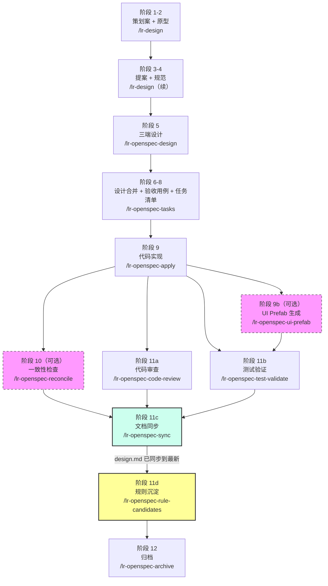
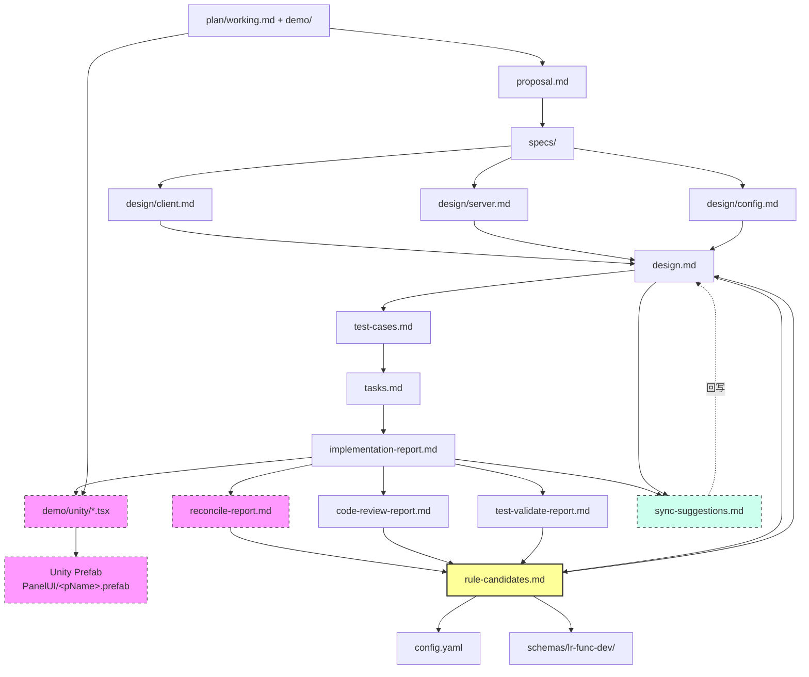

# 灵刃 OpenSpec 工作流

跨端（客户端/服务端/策划配置）功能开发的规范驱动流水线：策划案 → 原型验收 → 三端设计 → 实施 → 回写 → 验证 → 归档。

## SE 适配约定

- Unity：以 SE 工程 `ProjectSettings/ProjectVersion.txt` 为准，当前为 **2022.3.62f2**。
- 工程与知识库路径：相对于本目录 `config.yaml`；知识库入口为 `../develop/client/project/docs/ai-core/README.md`，编码规范也由该知识库路由。
- 配置生成：保留 SE 专有 `NeedParseDataMethod`，详见 [SE 配置生成约定](schemas/lr-func-dev/rules/common/se-config-generation.md)。
- **UI 优先 ai-game-developer MCP**：`lr-design` 优先读取 SE 真实 Prefab/组件作为原型参考；`lr-openspec-ui-prefab` 优先通过 MCP 生成并验证。先确认连接的 `Application.dataPath`，CLI 仅作不可用/能力不足时的兜底，详见 [UI MCP 约定](schemas/lr-func-dev/rules/common/unity-ui-mcp.md)。
- `.claude/skills/` 维护原始技能；`.agents/skills/` 只放 Codex 适配入口和展示配置。Codex 使用 `$skill-name`；原始说明保留 `/skill-name` 示例。只有 `lr-design`、`lr-plan-precheck` 允许自然语言隐式触发，后续阶段均显式调用且执行完停止。
- 本仓库使用 Git；开发工程按实际 SVN/Git 工作区识别。`changes/` 只提交 `archive/`，临时变更和运行依赖不纳入归档提交。


## 完整流程图



虚线框 = 可选阶段。阶段 9b 只在本次变更含客户端 UI 时需要，输入是阶段 9 定稿的 `[SerializeField]` 字段清单 + `lr-design` 已验收的 React 原型。

阶段 11c 放在测试验证之后，是因为此时代码改动量已经收敛——验收和测试过程中的反复修改都已落定，扫出来的差异不会在下一轮改动里被推翻，只跑一次就够。放在 11d 之前则保证 `rule-candidates` 是基于最新的 `design.md` 提炼规则，而不是拿一份已经过期的设计文档去沉淀。

技术上 `/lr-openspec-sync` 只依赖阶段 9（apply）完成，不检查 11a/11b 是否跑过，所以需要时也可以提前跑、跑多次（比如 code-review 发现设计漏项后立刻补一次）；11c 这个位置是推荐节奏，不是硬门禁。

---

## 阶段与 SKILL 对照表

| 阶段 | 产物 | 使用的 SKILL | 命令 | 必需/可选 |
|-----|------|-------------|------|---------|
| 1-2 | `plan/working.md`<br/>`demo/`（React 原型工程） | lr-design | `/lr-design <id>` | 必需 |
| 3-4 | `proposal.md`<br/>`specs/*.md` | lr-design（继续） | `/lr-design <id>` | 必需 |
| 5 | `design/client.md`<br/>`design/server.md`<br/>`design/config.md` | lr-openspec-design | `/lr-openspec-design <id>` | 必需 |
| 6-8 | `design.md`<br/>`test-cases.md`<br/>`tasks.md` | lr-openspec-tasks | `/lr-openspec-tasks <id>` | 必需 |
| 9 | 代码文件<br/>`implementation-report.md` | lr-openspec-apply | `/lr-openspec-apply <id> <role>` | 必需 |
| 9b | `demo/unity/*.tsx`<br/>Unity Prefab（`Assets/Resources/PanelUI/<pName>.prefab`） | lr-openspec-ui-prefab | `/lr-openspec-ui-prefab <id>` | 可选（含客户端 UI 时必需） |
| 10 | `reconcile-report.md` | lr-openspec-reconcile | `/lr-openspec-reconcile <id>` | 可选（多人协作推荐） |
| 11a | `code-review-report.md` | lr-openspec-code-review | `/lr-openspec-code-review <id>` | 推荐 |
| 11b | `test-validate-report.md` | lr-openspec-test-validate | `/lr-openspec-test-validate <id>` | 推荐 |
| 11c | `sync-suggestions.md`<br/>回写 `design.md` | lr-openspec-sync | `/lr-openspec-sync <id>` | 推荐（也可提前跑、跑多次） |
| 11d | `rule-candidates.md`<br/>回写 `config.yaml`/`schemas/`/`design.md` | lr-openspec-rule-candidates | `/lr-openspec-rule-candidates <id>` | 推荐 |
| 12 | `changes/archive/{日期}-{id}/` | lr-openspec-archive | `/lr-openspec-archive <id>` | 必需 |

---

## 完整命令示例

```bash
# 阶段 0（可选）：策划案预检——正式发起前自查"现在提交会被挑出哪些问题"
/lr-plan-precheck <飞书链接>
# 产物：只落本技能 tmp/ 的自检报告，不建 changes/ 目录，可无限次重复调用

# 阶段 1-4：策划提案
/lr-design growth-fund
# 产物：plan/working.md, demo/（React+Vite 原型工程）, proposal.md, specs/*.md

# 阶段 5：三端设计
/lr-openspec-design growth-fund
# 产物：design/client.md, design/server.md, design/config.md
# → 技术评审，解决所有 Open Questions

# 阶段 6-8：设计合并 + 用例 + 任务
/lr-openspec-tasks growth-fund
# 产物：design.md, test-cases.md, tasks.md

# 阶段 9：代码实现
/lr-openspec-apply growth-fund dev        # 前端+后端
/lr-openspec-apply growth-fund all        # 前端+后端+策划
# 产物：代码文件, implementation-report.md

# 阶段 9b：UI Prefab 生成（含客户端 UI 时执行）
/lr-openspec-ui-prefab growth-fund
# 产物：demo/unity/*.tsx, Assets/Resources/PanelUI/<pName>.prefab
# → 字段完整性校验必须零错误；Unity 批处理串行执行，勿并发

# 阶段 10：一致性检查（可选，多人协作推荐）
/lr-openspec-reconcile growth-fund
# 产物：reconcile-report.md

# 阶段 11a-11b：代码审查 + 测试验证（并行）
/lr-openspec-code-review growth-fund
/lr-openspec-test-validate growth-fund
# 产物：code-review-report.md, test-validate-report.md

# 阶段 11c：文档同步（代码此时已稳定，扫出的差异不会被下一轮改动推翻）
/lr-openspec-sync growth-fund
# 也可口头收窄范围："只同步协议参数" / "只同步 Record 表字段" / "同步 tasks.md"
# 产物：sync-suggestions.md
# → 人工编辑勾选，回复 'continue'，按勾选自动回写 design.md
# → 无差异时不生成文件，直接报告一致

# 阶段 11d：规则沉淀（基于 11c 同步后的 design.md）
/lr-openspec-rule-candidates growth-fund
# 产物：rule-candidates.md
# → 人工编辑勾选，回复 'continue'
# → 自动回写 config.yaml / schemas/lr-func-dev/ / design.md

# 阶段 12：归档
/lr-openspec-archive growth-fund
# → 合并 specs delta 到 openspec/specs/
# → 移动变更目录到 changes/archive/
```

---

## 角色分工

| 角色 | 负责阶段 | SKILL |
|-----|---------|------|
| **策划** | 0（可选）-4 | lr-plan-precheck（预检）、lr-design |
| **技术负责人/工程师** | 5-9 | lr-openspec-design, lr-openspec-tasks, lr-openspec-apply |
| **客户端 UI 工程师** | 9b | lr-openspec-ui-prefab |
| **质量保障** | 10-11b | lr-openspec-reconcile, lr-openspec-code-review, lr-openspec-test-validate |
| **知识沉淀** | 11c-11d | lr-openspec-sync, lr-openspec-rule-candidates |
| **归档负责人** | 12 | lr-openspec-archive |

---

## 渐进式增强

- **必需阶段**：1-9（策划到代码实现）+ 12（归档）
- **推荐阶段**：11a-11d（代码审查、测试验证、文档同步、规则沉淀）
- **可选阶段**：0（plan-precheck 策划案预检）、9b（ui-prefab，纯服务端/配置变更可跳过，含客户端 UI 时必需）、10（reconcile，单人全栈可跳过，多人协作强烈推荐）

---

## 阶段 11c 详解：`/lr-openspec-sync <id>`

扫描实际代码与 `design.md` 的差异，**只关注"代码有但设计文档没写"的遗漏**，生成 `sync-suggestions.md` 供人工勾选，回复 `continue` 后按勾选自动回写 `design.md`。无差异时不生成文件。

技术上只依赖阶段 9（apply）完成，不检查 11a/11b 是否跑过，因此需要时可提前跑、跑多次；排在 11b 之后是推荐节奏，不是硬门禁。

扫描四类差异：

| 类别 | 代码侧线索 | 对比目标 |
|-----|-----------|---------|
| 协议参数 | `args.IntVal(N)`（C→S）、`outArgs <<`（S→C） | design.md 附录A「网络协议」声明的参数数量 |
| Record 表字段 | `RecCol.FieldName` 的 `GetInt`/`SetInt` | design.md Record 表定义 |
| 配置表字段 | `txt.ReadInt/ReadString("字段名")` | design.md 配置表字段定义 |
| UI 组件（客户端） | `m_` 前缀的 `Button`/`TextMeshProUGUI` 等字段 | design.md「UI 组件映射」表 |

协议参数必须**双向检查**：C→S（服务端解析入参）和 S→C（服务端下发，含同步 RPC 的返回值）是两条独立数据流，字段数量可能完全不同。方向 B 不能只 Grep `outArgs <<` 的行数——写在循环里的话数不出"每组重复几个字段"，必须完整读出函数体，分别数清循环外一次性字段数和循环内每次迭代字段数。

可口头收窄范围："只同步协议参数" / "只同步 Record 表字段" / "同步 tasks.md"（默认只同步 design.md）。

### sync / reconcile / rule-candidates 的分工

三者都涉及"代码与文档对不上"，但定位不同，不要互相替代：

| 维度 | sync（阶段 11c） | reconcile（阶段 10） | rule-candidates（阶段 11d） |
|-----|------|-----------|-----------------|
| 定位 | 轻量、可反复运行的文档同步 | 深度一致性检查（含命名风格、参数顺序） | 归档前一次性总结（含规则沉淀、schema 优化） |
| 输出 | `sync-suggestions.md` | `reconcile-report.md`（只读报告） | `rule-candidates.md` |
| 自动回写 | 是（`design.md`） | 否，只列差异 | 是（`design.md`/`config.yaml`/`schemas/`） |
| 频率 | 11b 后一次，也可提前多次 | 一次（多人协作场景） | 一次（归档前） |

sync 不判断代码对错（那是 code-review 的事），不检查测试覆盖（test-validate），不沉淀规则到 `config.yaml`/`schemas/`（rule-candidates）。发现的差异如果其实是代码写错了，不勾选该建议即可——sync 只列"疑似遗漏"，改文档还是改代码由人决定。

---

## 产物依赖图



---

## 知识循环

```
本次变更 → 发现问题 → 记录到报告（reconcile/code-review/test-validate）
  ↓
文档同步 → 代码有但设计漏写 → 回写 design.md（保证下一步基于最新设计）
  ↓
规则沉淀 → 共性问题 → 写入 config.yaml / schemas/lr-func-dev/
  ↓
下次变更 → 规则自动注入 → AI 自动避开已知陷阱
  ↓
持续改进 → schema 优化 → reconcile/code-review 能力增强
```

---

## 相关文档

- [OpenSpec 小白学习指南](./OpenSpec小白学习指南.md) — 首次接触 OpenSpec 的入门读物
- [OpenSpec 高级精通指南](./OpenSpec高级精通指南.md) — 深入理解产物 DAG、schema 定制、config 系统
- `schemas/lr-func-dev/schema.yaml` — 本项目的自定义工作流 schema 定义
- `config.yaml` — 项目级配置（技术栈、职责边界、按产物注入的规则）

---

## 目录结构

```
openspec/
├── README.md                          # 本文档
├── CLAUDE.md                          # AI 执行者的阶段边界规则（防止越界串阶段）
├── AGENTS.md                          # 通用 AI 执行者须知
├── config.yaml                        # 项目级配置（技术栈、职责边界、按产物注入的规则）
├── OpenSpec小白学习指南.md / OpenSpec高级精通指南.md
├── schemas/lr-func-dev/               # 自定义工作流 schema
│   ├── schema.yaml                    # 产物 DAG 定义
│   ├── templates/                     # 各产物模板（proposal / design / test-cases / tasks）
│   └── rules/                         # 生成规则（不可从代码推理的知识）
│       ├── common/                    # 通用规则（编译验证、孤儿检查）
│       ├── design/                    # 三端设计生成规则（client / server / config）
│       ├── tasks/                     # 任务拆分规则（client / server / config）
│       └── apply/                     # 三端实施执行规则（client / server / config）
├── .claude/skills/                    # 全部 SKILL：lr-design、lr-plan-precheck、lr-openspec-*
├── .agents/skills/                    # Codex 薄适配器（SKILL.md + agents/openai.yaml，不复制原始实现）
├── doc/                               # 策划案转换稿（xlsx → markdown + images/，lr-design 的输入）
│   └── <功能名>/
├── changes/                           # 活跃变更（未归档）
│   └── <change-id>/
│       ├── .openspec.yaml             # 变更绑定的 schema（lr-func-dev）
│       ├── plan/working.md            # 策划案工作稿（plan/images/ 附图）
│       ├── proposal.md
│       ├── specs/<capability>/spec.md
│       ├── design/{client,server,config}.md
│       ├── design.md                  # 阶段 6-8 合并后的最终设计
│       ├── test-cases.md
│       ├── tasks.md
│       ├── demo/                      # React + Vite 原型工程（src/*.tsx，构建到 dist/）
│       │   ├── src/                   # 原型源码（含 components/、data.ts 等）
│       │   ├── dist/                  # 构建产物
│       │   └── unity/                 # 阶段 9b：*.tsx + 转换后的 *.json（含客户端 UI 时）
│       ├── implementation-report.md
│       ├── Language_Keys.md           # apply 产出的语言表 key 清单（待导入 language.xlsx）
│       ├── reconcile-report.md        # 可选（阶段 10）
│       ├── code-review-report.md      # 阶段 11a
│       ├── test-validate-report.md    # 阶段 11b
│       ├── sync-suggestions.md        # 阶段 11c（无差异时不生成）
│       └── rule-candidates.md         # 阶段 11d
├── specs/                             # 主规范（归档后合并的最终状态）
└── changes/archive/                   # 已归档的历史变更
```
