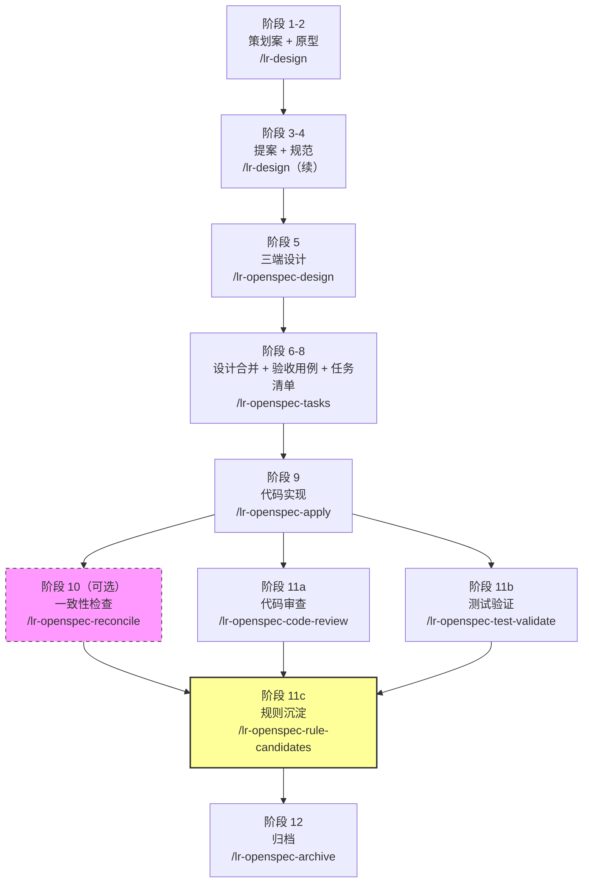
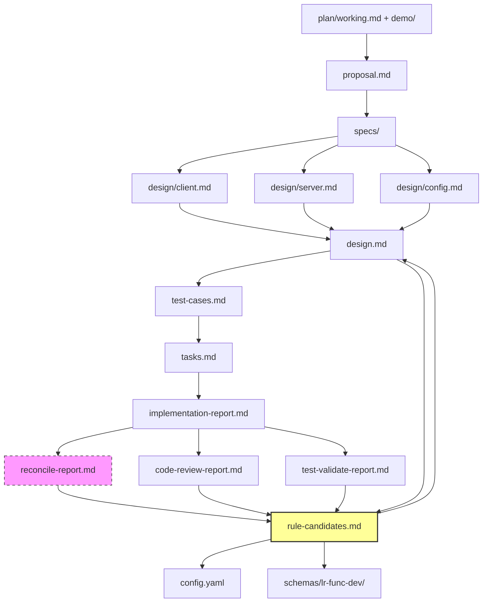

# 灵刃 OpenSpec 工作流

跨端（客户端/服务端/策划配置）功能开发的规范驱动流水线：策划案 → 原型验收 → 三端设计 → 实施 → 回写 → 验证 → 归档。

## 完整流程图



虚线框 = 可选阶段

---

## 阶段与 SKILL 对照表

| 阶段 | 产物 | 使用的 SKILL | 命令 | 必需/可选 |
|-----|------|-------------|------|---------|
| 1-2 | `plan/working.md`<br/>`demo/*.html` | lr-design | `/lr-design <id>` | 必需 |
| 3-4 | `proposal.md`<br/>`specs/*.md` | lr-design（继续） | `/lr-design <id>` | 必需 |
| 5 | `design/client.md`<br/>`design/server.md`<br/>`design/config.md` | lr-openspec-design | `/lr-openspec-design <id>` | 必需 |
| 6-8 | `design.md`<br/>`test-cases.md`<br/>`tasks.md` | lr-openspec-tasks | `/lr-openspec-tasks <id>` | 必需 |
| 9 | 代码文件<br/>`implementation-report.md` | lr-openspec-apply | `/lr-openspec-apply <id> <role>` | 必需 |
| 10 | `reconcile-report.md` | lr-openspec-reconcile | `/lr-openspec-reconcile <id>` | 可选（多人协作推荐） |
| 11a | `code-review-report.md` | lr-openspec-code-review | `/lr-openspec-code-review <id>` | 推荐 |
| 11b | `test-validate-report.md` | lr-openspec-test-validate | `/lr-openspec-test-validate <id>` | 推荐 |
| 11c | `rule-candidates.md`<br/>回写 `config.yaml`/`schemas/`/`design.md` | lr-openspec-rule-candidates | `/lr-openspec-rule-candidates <id>` | 推荐 |
| 12 | `changes/archive/{日期}-{id}/` | lr-openspec-archive | `/lr-openspec-archive <id>` | 必需 |

---

## 完整命令示例

```bash
# 阶段 1-4：策划提案
/lr-design growth-fund
# 产物：plan/working.md, demo/*.html, proposal.md, specs/*.md

# 阶段 5：三端设计
/lr-openspec-design growth-fund
# 产物：design/client.md, design/server.md, design/config.md
# → 技术评审，解决所有 Open Questions

# 阶段 6-8：设计合并 + 用例 + 任务
/lr-openspec-tasks growth-fund
# 产物：design.md, test-cases.md, tasks.md

# 阶段 9：代码实现
/lr-openspec-apply growth-fund dev        # 前端+后端
/lr-openspec-apply growth-fund all        # 前端+后端+策划
# 产物：代码文件, implementation-report.md

# 阶段 10：一致性检查（可选，多人协作推荐）
/lr-openspec-reconcile growth-fund
# 产物：reconcile-report.md

# 阶段 11a-11b：代码审查 + 测试验证（并行）
/lr-openspec-code-review growth-fund
/lr-openspec-test-validate growth-fund
# 产物：code-review-report.md, test-validate-report.md

# 阶段 11c：规则沉淀
/lr-openspec-rule-candidates growth-fund
# 产物：rule-candidates.md
# → 人工编辑勾选，回复 'continue'
# → 自动回写 config.yaml / schemas/lr-func-dev/ / design.md

# 阶段 12：归档
/lr-openspec-archive growth-fund
# → 合并 specs delta 到 openspec/specs/
# → 移动变更目录到 changes/archive/
```

---

## 角色分工

| 角色 | 负责阶段 | SKILL |
|-----|---------|------|
| **策划** | 1-4 | lr-design |
| **技术负责人/工程师** | 5-9 | lr-openspec-design, lr-openspec-tasks, lr-openspec-apply |
| **质量保障** | 10-11b | lr-openspec-reconcile, lr-openspec-code-review, lr-openspec-test-validate |
| **知识沉淀** | 11c | lr-openspec-rule-candidates |
| **归档负责人** | 12 | lr-openspec-archive |

---

## 渐进式增强

- **必需阶段**：1-9（策划到代码实现）+ 12（归档）
- **推荐阶段**：11a-11c（代码审查、测试验证、规则沉淀）
- **可选阶段**：10（reconcile，单人全栈可跳过，多人协作强烈推荐）

---

## 产物依赖图



---

## 知识循环

```
本次变更 → 发现问题 → 记录到报告（reconcile/code-review/test-validate）
  ↓
规则沉淀 → 共性问题 → 写入 config.yaml / schemas/lr-func-dev/
  ↓
下次变更 → 规则自动注入 → AI 自动避开已知陷阱
  ↓
持续改进 → schema 优化 → reconcile/code-review 能力增强
```

---

## 相关文档

- [OpenSpec 小白学习指南](./OpenSpec小白学习指南.md) — 首次接触 OpenSpec 的入门读物
- [OpenSpec 高级精通指南](./OpenSpec高级精通指南.md) — 深入理解产物 DAG、schema 定制、config 系统
- `schemas/lr-func-dev/schema.yaml` — 本项目的自定义工作流 schema 定义
- `config.yaml` — 项目级配置（技术栈、职责边界、按产物注入的规则）

---

## 目录结构

```
openspec/
├── README.md                          # 本文档
├── config.yaml                        # 项目级配置
├── schemas/lr-func-dev/                # 自定义工作流 schema
│   ├── schema.yaml                    # 产物 DAG 定义
│   ├── templates/                     # 各产物模板
│   └── rules/                         # 生成规则（不可从代码推理的知识）
│       ├── design/                    # 三端设计生成规则
│       └── tasks/                     # 任务拆分规则
├── .claude/skills/                    # 所有 lr-openspec-* SKILL
├── changes/                           # 活跃变更（未归档）
│   └── <change-id>/
│       ├── plan/working.md
│       ├── demo/*.html
│       ├── proposal.md
│       ├── specs/**/*.md
│       ├── design/{client,server,config}.md
│       ├── design.md
│       ├── test-cases.md
│       ├── tasks.md
│       ├── implementation-report.md
│       ├── reconcile-report.md        # 可选
│       ├── code-review-report.md
│       ├── test-validate-report.md
│       └── rule-candidates.md
├── specs/                             # 主规范（归档后合并的最终状态）
└── changes/archive/                   # 已归档的历史变更
```
