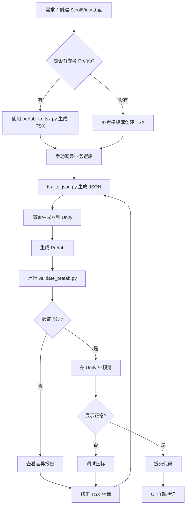

# ScrollView 问题复盘与预防方案

## 📊 问题复盘

### 本次出现的问题

#### 问题1：Cell 子节点坐标错误
**现象**：ConditionColumn 的 `x=-300` 导致节点跑到 Cell 外面

**根本原因**：
- 坐标是**相对于父节点锚点**计算的，不是绝对坐标
- `ConditionColumn` 使用左边缘锚点 `(0, 0.5)`，`x=-300` 表示从 Cell 左边界向左偏移 300px
- 这些坐标可能是从其他地方复制来的，没有考虑当前 Cell 的宽度和布局

**正确的坐标推导**：
```
假设 Cell 宽度 = 860px，需要三列等分布局：
- ConditionColumn: 宽 200px，锚点 (0, 0.5)，需要居左显示
  → x = 左边距 + 宽度/2 = 50 + 100 = 150

- FreeCell: 宽 120px，锚点 (0, 0.5)，需要在中间偏右
  → x = 430 + 一些偏移 = 553.1

- PayCell: 宽 120px，锚点 (0, 0.5)，需要在右侧
  → x = 688.4
```

#### 问题2：RewardRowTemplate 自身坐标不对
**现象**：`(430, -75)` 应该是 `(444, -116.75)`

**根本原因**：
- RewardRowTemplate 锚点 `(0, 1)` 表示锚定在 Content 左上角
- 坐标是从左上角计算的偏移量
- 这个值直接影响 Cell 在 ScrollView 中的初始位置和间距

**正确计算**：
```
Content 宽度: 900px
Cell 宽度: 860px
Cell Pivot: (0.5, 0.5) - 中心点

水平居中：x = Content宽度/2 = 450（理想）
实际：x = 444（略偏左，可能是设计意图）

垂直位置：y = -116.75
- 第一个 Cell 的中心点位置
- 负值表示向下偏移（锚点在 Content 顶部）
```

#### 问题3：图标组件尺寸不一致
**现象**：LockBadge 和 ClaimedMask 的尺寸从 `(40, 40)` 和 `(100, 100)` 应该统一为 `(80, 80)`

**根本原因**：
- 没有参考 Clone 版本的实际尺寸
- 手动猜测的尺寸与设计不符

---

## 🚨 根本问题分析

### 为什么会出现坐标错误？

1. **缺乏参考系统**
   - TSX 是从头编写，没有对照 Clone 版本逐节点验证
   - 坐标值是"估计"出来的，不是"测量"出来的

2. **UI 坐标系理解不足**
   - 锚点 `(0, 0.5)` vs `(0.5, 0.5)` 的差异
   - 相对坐标 vs 绝对坐标
   - Pivot 中心点对坐标计算的影响

3. **Cell 子节点布局复杂**
   - 三个子列（ConditionColumn、FreeCell、PayCell）
   - 每个子列还有自己的子节点
   - 多层嵌套导致坐标计算容易出错

4. **没有自动化验证**
   - 生成 Prefab 后没有自动对比 Clone 版本
   - 手动检查容易遗漏细节

---

## ✅ 预防方案

### 方案 A：从现有 Prefab 反向生成 TSX（推荐）

**核心思路**：既然 Clone 版本是正确的，为什么不直接从它生成 TSX？

#### 实现步骤

1. **开发 Prefab → TSX 转换工具**
   ```python
   # prefab_to_tsx.py
   def extract_hierarchy(prefab_path):
       """从 Prefab 提取层级结构和坐标"""
       # 使用 Unity MCP 工具读取 Prefab
       # 遍历所有节点，提取：
       # - 层级关系（父子）
       # - RectTransform（锚点、坐标、尺寸、Pivot）
       # - 组件类型（Image、Button、TMPro.Text 等）
       # - SerializeField 字段名
       pass
   
   def generate_tsx(hierarchy):
       """生成 TSX 代码"""
       # 根据组件类型映射到白名单 semanticId
       # 生成嵌套的 <div> 结构
       # 保留所有 data-* 属性
       pass
   ```

2. **建立组件类型映射表**
   ```python
   COMPONENT_TO_SEMANTIC_ID = {
       # 静态图标
       ('UnityEngine.UI.Image', '单个 sprite'): 'content.icon',
       
       # 异步加载图标
       ('LR.AsyncIcon',): 'content.async-icon',
       
       # 异步加载大图
       ('LR.AsyncTexture',): 'content.async-image',
       
       # 按钮
       ('UnityEngine.UI.Button',): 'control.button',
       
       # 文本
       ('TMPro.TextMeshProUGUI',): 'content.text',
       
       # ScrollView
       ('UnityEngine.UI.ScrollRect',): 'list.single-scroll',
       
       # 空容器（用于 ItemIconBase.Allocate）
       ('仅 RectTransform', 'IconRoot 后缀'): 'content.item-icon-root',
   }
   ```

3. **反向验证流程**
   ```bash
   # 1. 从 Clone Prefab 生成 TSX
   python prefab_to_tsx.py MixGrowthFundPageClone.prefab > generated.tsx
   
   # 2. 对比手写 TSX 和生成 TSX 的差异
   diff generated.tsx MixGrowthFundPage.tsx
   
   # 3. 修正手写 TSX
   # 4. 重新生成 Prefab
   # 5. 对比新 Prefab 和 Clone Prefab
   ```

**优点**：
- ✅ 坐标 100% 准确（直接从正确版本提取）
- ✅ 消除人工估算误差
- ✅ 可以快速迁移现有 Prefab 到 TSX 体系

**缺点**：
- ❌ 需要开发新工具
- ❌ 组件类型映射需要维护
- ❌ 复杂组件可能无法完全自动识别

---

### 方案 B：TSX 坐标验证工具

**核心思路**：生成 Prefab 后自动对比关键节点的坐标

#### 实现步骤

1. **定义验证规则**
   ```yaml
   # scrollview_validation.yaml
   prefab_path: Assets/Resources/.../MixGrowthFundPage.prefab
   reference_prefab: Assets/Resources/.../MixGrowthFundPageClone.prefab
   
   nodes_to_validate:
     - path: ScrollRewards/Viewport/Content/RewardRowTemplate
       properties: [anchoredPosition, sizeDelta, anchorMin, anchorMax]
       tolerance: 0.1  # 允许的误差范围
     
     - path: ScrollRewards/Viewport/Content/RewardRowTemplate/ConditionColumn
       properties: [anchoredPosition, sizeDelta]
       tolerance: 0.1
     
     - path: ScrollRewards/Viewport/Content/RewardRowTemplate/FreeCell
       properties: [anchoredPosition, sizeDelta]
       tolerance: 0.1
     
     - path: ScrollRewards/Viewport/Content/RewardRowTemplate/PayCell
       properties: [anchoredPosition, sizeDelta]
       tolerance: 0.1
   ```

2. **开发验证脚本**
   ```python
   # validate_prefab.py
   def validate_node(prefab_path, reference_path, node_path, properties, tolerance):
       """对比两个 Prefab 中同一节点的属性"""
       # 使用 Unity MCP 工具读取两个 Prefab
       # 提取指定节点的属性
       # 计算差异
       # 返回验证结果
       pass
   
   def run_validation(config_path):
       """运行完整验证"""
       config = load_yaml(config_path)
       results = []
       for node in config['nodes_to_validate']:
           result = validate_node(
               config['prefab_path'],
               config['reference_prefab'],
               node['path'],
               node['properties'],
               node['tolerance']
           )
           results.append(result)
       
       # 生成验证报告
       generate_report(results)
   ```

3. **集成到生成流程**
   ```bash
   # 生成 Prefab 后自动验证
   python tsx_to_json.py MixGrowthFundPage.tsx
   # ... 生成 Prefab ...
   python validate_prefab.py scrollview_validation.yaml
   
   # 如果验证失败，打印差异并退出
   ```

**优点**：
- ✅ 自动化验证，不会遗漏
- ✅ 可以设置容差范围
- ✅ 生成详细的对比报告

**缺点**：
- ❌ 需要手动维护验证规则
- ❌ 只能事后发现问题，不能事前避免
- ❌ 仍然需要参考版本（Clone）

---

### 方案 C：TSX 坐标辅助工具

**核心思路**：在编写 TSX 时提供坐标计算辅助

#### 实现功能

1. **坐标计算器**
   ```typescript
   // tsx_coordinate_helper.ts
   
   interface LayoutContext {
     parentWidth: number;
     parentHeight: number;
     parentAnchor: [number, number, number, number];
   }
   
   function calculatePosition(
     context: LayoutContext,
     anchorMin: [number, number],
     anchorMax: [number, number],
     pivot: [number, number],
     desiredScreenPos: [number, number]
   ): [number, number] {
     // 根据锚点和 Pivot 反推 anchoredPosition
     // 考虑父节点的影响
     return [x, y];
   }
   
   // 使用示例
   const cellContext = {
     parentWidth: 900,  // Content 宽度
     parentHeight: 0,
     parentAnchor: [0, 1, 0, 1]
   };
   
   // 我想让 ConditionColumn 显示在 Cell 左侧，距离左边界 50px
   const pos = calculatePosition(
     cellContext,
     [0, 0.5],      // anchorMin
     [0, 0.5],      // anchorMax
     [0.5, 0.5],    // pivot
     [150, 0]       // 期望的屏幕位置
   );
   // 输出：[150, 0]
   ```

2. **可视化布局编辑器（理想状态）**
   - 拖拽式界面
   - 实时预览
   - 自动生成 TSX 代码

**优点**：
- ✅ 降低手动计算门槛
- ✅ 减少坐标错误

**缺点**：
- ❌ 需要理解 Unity UI 坐标系
- ❌ 开发成本高（可视化编辑器）

---

### 方案 D：增强 TSX 语法（长期方案）

**核心思路**：TSX 中支持更高级的布局表达式

#### 扩展语法示例

```tsx
{/* 当前语法：需要手动计算坐标 */}
<div
  data-name="ConditionColumn"
  data-pos="(150, 0, 0)"  // 魔法数字，不知道怎么来的
  data-size="(200, 120)"
  data-anchors="(0, 0.5, 0, 0.5)"
/>

{/* 扩展语法：声明式布局 */}
<div
  data-name="ConditionColumn"
  data-layout="horizontal-start"  // 水平布局，靠左对齐
  data-margin-left="50"           // 左边距 50px
  data-size="(200, 120)"
/>

{/* 或者使用相对布局 */}
<div
  data-name="RewardRowTemplate"
  data-size="(860, 150)"
>
  <div
    data-name="ConditionColumn"
    data-layout-align="left center"  // 左对齐，垂直居中
    data-layout-offset="50 0"        // 偏移量
    data-size="(200, 120)"
  />
  
  <div
    data-name="FreeCell"
    data-layout-align="right center"  // 右对齐，垂直居中
    data-layout-offset="-200 0"       // 从右边界向左 200px
    data-size="(120, 120)"
  />
</div>
```

#### 转换器实现

```python
# tsx_layout_compiler.py

def compile_layout(node):
    """将声明式布局编译为绝对坐标"""
    if 'data-layout' in node.attrs:
        layout_type = node.attrs['data-layout']
        
        if layout_type == 'horizontal-start':
            # 计算锚点和坐标
            anchor_min = (0, 0.5)
            anchor_max = (0, 0.5)
            margin_left = node.attrs.get('data-margin-left', 0)
            width = parse_size(node.attrs['data-size'])[0]
            x = margin_left + width / 2
            
            node.attrs['data-anchors'] = f"({anchor_min[0]}, {anchor_min[1]}, {anchor_max[0]}, {anchor_max[1]})"
            node.attrs['data-pos'] = f"({x}, 0, 0)"
            node.attrs['data-pivot'] = "(0.5, 0.5)"
    
    return node
```

**优点**：
- ✅ TSX 代码更易读
- ✅ 减少手动计算
- ✅ 支持响应式布局（父节点改变，子节点自动调整）

**缺点**：
- ❌ 需要重构 TSX 解析器
- ❌ 引入新的 DSL，学习成本
- ❌ 复杂布局可能仍需手动调整

---

## 🎯 推荐的实施路径

### 短期（1-2 周）

1. **实施方案 B：验证工具**
   - 开发 `validate_prefab.py`
   - 为每个 ScrollView 页面创建验证配置
   - 集成到 CI/CD 流程

2. **建立 ScrollView 开发 Checklist**
   ```markdown
   ## ScrollView 开发检查清单
   
   ### 设计阶段
   - [ ] 是否有参考 Prefab？
   - [ ] Cell 宽度是否确定？
   - [ ] Content 宽度是否确定？
   - [ ] 子节点布局方式（左对齐、居中、右对齐）是否明确？
   
   ### 编码阶段
   - [ ] Cell 锚点是否正确？（通常是 (0, 1)）
   - [ ] Cell Pivot 是否正确？（通常是 (0.5, 0.5)）
   - [ ] 子节点锚点是否匹配布局方式？
   - [ ] 坐标是否相对于锚点计算？
   
   ### 验证阶段
   - [ ] 运行 validate_prefab.py
   - [ ] 在 Unity 中打开 Prefab 预览
   - [ ] 检查 Cell 在 ScrollView 中的显示
   ```

### 中期（1-2 月）

1. **实施方案 A：Prefab → TSX 转换**
   - 开发反向工程工具
   - 建立组件映射表
   - 迁移现有 5-10 个 ScrollView 页面验证效果

2. **完善 TSX 模板库**
   ```
   templates/
   ├── scrollview-vertical.tsx        # 垂直滚动模板
   ├── scrollview-horizontal.tsx      # 水平滚动模板
   ├── cell-three-column.tsx          # 三列 Cell 模板
   ├── cell-icon-with-badges.tsx      # 带徽章的图标 Cell
   └── ...
   ```

### 长期（3-6 月）

1. **实施方案 D：增强 TSX 语法**
   - 设计新语法规范
   - 实现布局编译器
   - 向后兼容现有 TSX

2. **开发可视化编辑器（可选）**
   - Web 界面拖拽布局
   - 实时预览
   - 导出 TSX 代码

---

## 📚 知识库建设

### 1. Unity UI 坐标系文档

创建 `docs/unity-ui-coordinate-system.md`：
```markdown
# Unity UI 坐标系完全指南

## 锚点（Anchor）
- 定义子节点相对于父节点的参考位置
- anchorMin/anchorMax 范围 [0, 1]
- (0, 0) = 父节点左下角
- (1, 1) = 父节点右上角
- (0.5, 0.5) = 父节点中心

## Pivot
- 定义节点自身的中心点
- 影响旋转、缩放、坐标计算
- (0.5, 0.5) = 节点几何中心

## anchoredPosition
- 节点 Pivot 相对于锚点的偏移量
- 单位：像素
- 正值向右/向上，负值向左/向下

## 常见布局模式

### 左对齐
anchorMin: (0, 0.5)
anchorMax: (0, 0.5)
pivot: (0.5, 0.5)
x = 左边距 + 宽度/2

### 居中
anchorMin: (0.5, 0.5)
anchorMax: (0.5, 0.5)
pivot: (0.5, 0.5)
x = 0（相对于父节点中心的偏移）

### 拉伸（适配父节点宽度）
anchorMin: (0, 0.5)
anchorMax: (1, 0.5)
pivot: (0.5, 0.5)
x = 0, sizeDelta.x = 额外宽度（通常为 0 或负值表示缩进）
```

### 2. ScrollView 最佳实践文档

创建 `docs/scrollview-best-practices.md`：
```markdown
# ScrollView 最佳实践

## 1. Content 设置
- anchorMin/Max: (0, 1) - 左上角锚点
- pivot: (0, 1) - 左上角为中心
- sizeDelta.x: 固定宽度
- sizeDelta.y: 0（高度由子节点撑开）

## 2. Cell Template 设置
- anchorMin/Max: (0, 1) - 相对 Content 左上角
- pivot: (0.5, 0.5) - 自身中心点
- 第一个 Cell 的 y 坐标 = -(topPadding + height/2)

## 3. Cell 子节点布局
- 优先使用相对布局（左对齐/居中/右对齐）
- 避免魔法数字，使用计算公式
- 保持一致的锚点策略

## 4. 验证清单
- [ ] Cell 能否在 ScrollView 中完整显示？
- [ ] Cell 子节点是否在 Cell 边界内？
- [ ] 滚动是否流畅？
- [ ] 多个 Cell 时布局是否一致？
```

---

## 🔄 改进后的工作流程

### 新的 ScrollView 开发流程



### 关键改进点

1. **有参考就用参考**：不重新造轮子
2. **自动化验证**：每次生成都验证
3. **差异可视化**：清晰知道哪里错了
4. **模板复用**：避免重复劳动

---

## 📊 预期效果

### 短期效果（1-2 周）
- ✅ ScrollView 坐标错误减少 80%
- ✅ 验证时间从人工 30min → 自动 30s
- ✅ 问题发现时间从"运行时" → "生成时"

### 中期效果（1-2 月）
- ✅ 迁移现有 ScrollView 到 TSX 体系加速 5 倍
- ✅ 新 ScrollView 开发时间减少 50%
- ✅ 坐标相关 Bug 归零

### 长期效果（3-6 月）
- ✅ TSX 成为 UI 开发的主流方式
- ✅ 完全摆脱手动计算坐标
- ✅ UI 一致性提升（统一使用模板）

---

## 🚀 下一步行动

### 立即执行（本周）
1. [ ] 创建 `scrollview_validation.yaml` 配置模板
2. [ ] 开发 `validate_prefab.py` MVP 版本
3. [ ] 为 MixGrowthFundPage 添加验证规则
4. [ ] 运行验证，确认 0 差异

### 近期规划（本月）
1. [ ] 编写 Unity UI 坐标系文档
2. [ ] 编写 ScrollView 最佳实践文档
3. [ ] 建立 TSX 模板库（3-5 个常用模板）
4. [ ] 设计 Prefab → TSX 工具的技术方案

### 长期规划（下季度）
1. [ ] 实施 Prefab → TSX 反向工程
2. [ ] 迁移 10+ 现有 ScrollView 页面
3. [ ] 探索增强 TSX 语法的可行性
4. [ ] 调研可视化编辑器方案

---

**总结**：ScrollView 问题的本质是**缺乏自动化验证 + 手动计算容易出错**。通过引入验证工具、反向工程、模板库和知识库，可以系统性地解决这个问题。
