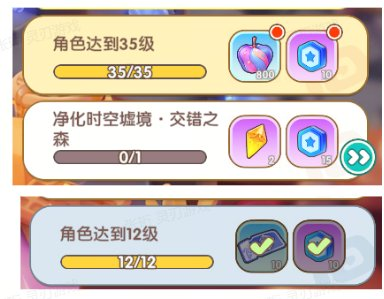

# 基金活动_周鑫

# 《重返地心之下》基金活动 - 功能策划案

**版本号**: v1.2
**撰写日期**: 2026-07-13
**适用项目**: 重返地心之下
**策划人**: 周鑫
**所属团队**: 灵刃游戏-策划部-运营组
**文档状态**: 评审稿

---

## 一、项目概述与设计总纲

### 1.1 设计定位

| 维度 | 说明 |
| --- | --- |
| **活动类型** | 商业化常驻/限时活动（充值型福利） |
| **所属系统** | 福利系统 / 商城系统 / 活动中心 |
| **核心目的** | 充值拉收、活动拉新、长期留存 |
| **周期形态** | 多基金并存：自然时间基金（限时）+ 永久时间基金（永续售卖 / 限时领取） |
| **持续时间** | 自然时间基金 = 配置起止时间；永久时间基金 = 不限购买期，配置领取天数 |
| **目标用户** | 所有达到 func 表开启等级的玩家（含付费/非付费） |
| **解锁形态** | 条件解锁型（等级 / 爬塔层数 / 累计登录 / 任务完成 等可配置） |
| **奖励结构** | 免费奖励（全玩家）+ 投资奖励（付费玩家）双轨 |

### 1.2 设计目标

1. **核心商业化目标**：单基金档位 GMV 拉收；多基金并存提升玩家付费频次与客单价
1. **核心体验目标**：一次性付费、条件解锁返利，玩家获得感强、退款风险低
1. **运营目标**：配置化（基金类型、价格、奖励、条件均可热更新），多档位独立上下架
1. **系统联动目标**：与通行证、累计登录、赛季商店形成付费/活跃正循环
1. **风控目标**：自然时间不足时**不损失玩家已得权益**（保留完整奖励 + 延长领取期）
### 1.3 多基金并存设计总览

| 维度 | 设计说明 |
| --- | --- |
| **并存数量** | 同一时间最多并存 N 只基金（推荐 N=3，避免选择疲劳） |
| **区分手段** | 背景图 + 名称 + 价格 + 奖励内容（每只基金独立配置） |
| **互斥规则** | 默认独立可叠加购买；可配 `mutex_group` 字段实现互斥（同一组内不可重复买） |
| **入口展示** | 基金主面板采用 Tab 切换（成长计划 / 铭文计划 / 爬塔回赠 等） |
| **数据隔离** | 每只基金独立购买记录、独立领取记录、独立状态机 |

---

## 二、系统/玩法设计说明

### 2.1 UI FLOW图

主界面活动入口


打开活动界面


#### 2.1.2 条件解锁机制

基金奖励通过**达成条件**逐档解锁，而非每日固定发放。条件类型可配置：

| 条件类型 | `condition_type` | 说明 | 示例 |
| --- | --- | --- | --- |
| 等级解锁 | `LEVEL` | 玩家达到指定等级解锁 | 30级 / 35级 / 40级 ... |
| 爬塔层数 | `TOWER_FLOOR` | 爬塔达到指定层数解锁 | 梦境之塔3-5层 / 3-10层 ... |
| 累计登录 | `CUMULATIVE_LOGIN` | 累计登录天数解锁 | 累计登录7天 / 14天 / 30天 |
| 任务完成 | `QUEST` | 完成指定任务解锁 | 完成主线第X章 |
| 战力达成 | `POWER` | 战力达到指定值解锁 | 战力达到10万 / 20万 ... |

**推荐默认**：等级解锁（最通用、玩家预期最清晰）。爬塔 / 累计登录作为扩展类型。

**【决策】条件类型为配置化字段**：每档奖励对应的解锁条件类型（`ConditionType`：`LEVEL`/`TOWER_FLOOR`/`CUMULATIVE_LOGIN`/`QUEST`/`POWER`之一）和条件数值（`ConditionValue`）均由配置表驱动，不同基金/不同档位可配出不同条件。本次原型只需实现**一种基金类型**（一套完整档位配置）跑通完整流程，不需要展示多基金 Tab 切换或多种条件类型混排；策划配置时通过 `ActiveId` 差异化出不同解锁条件的基金。

#### 2.1.4 奖励列表布局与档位标识

**【决策】列表布局**：单列表格，每行 = 一档，从左到右依次为：**条件进度列 | 免费奖励列 | 投资奖励列**（+ 领取按钮，见 5.3）。

**【决策】档位标识**：不显示档位编号（不显示"第1档""第2档"等序号），玩家通过条件进度列的文案（如"等级30可领""爬塔3-5层可领"）识别该档要求，而非序号。

**【决策】整体进度**：不展示全局进度条（不显示"已解锁3/10"）。每一行（每个 Cell）内部展示该档自身的条件进度（如"当前25/30级"或"已登录5/7天"）。

**【决策】终极大奖**：不设独立展示区，最后一档与其他档位平等呈现（不额外放大图标或加特效）。

**【决策】一键领取（已变更）**：点击任意可领取格子即一键领取该活动下所有可领取奖励（免费+投资），不新增独立按钮，复用服务端 `OnBizActivCustomQuickGetAllReward`（`SendQuickGetAllRewardMsg`）。原"逐档点击对应行领取按钮"的决策已废弃。

#### 2.1.3 双轨奖励结构

每档条件对应两列奖励：

| 奖励列 | 领取条件 | 说明 |
| --- | --- | --- |
| **免费奖励** | 达成条件即可领 | 所有玩家都能领，用于拉活跃 |
| **投资奖励** | 达成条件 + 已购买基金 | 付费玩家额外奖励，价值更高 |

**投资奖励价值设计原则**：

- 投资奖励总价值 ≥ 售价的 10 倍（参考图1为 18+ 倍，图2为 13 倍）
- 首档（购买立得）返还比例 ≥ 售价的 100%（降低付费门槛感知）
- 终极大奖（最后一档）价值占总投资奖励的 20%-30%（驱动玩家推进到底）
### 2.4 领取奖励机制

#### 2.4.1 领取形态

| 形态 | 字段 | 适用场景 |
| --- | --- | --- |
| **条件解锁**（默认） | `claim_mode = CONDITION` | 达成条件后领取，逐档推进 |
| 每日返利 | `claim_mode = DAILY` | 30 天每日 1 份，强化留存 |
| 累计返利 | `claim_mode = CUMULATIVE_LOGIN` | 30 天内累计登录 N 天返利 |
| 阶梯返利 | `claim_mode = LADDER` | 第 1/3/7/14/30 天返利 |
| 一次性返利 | `claim_mode = ONCE` | 购买当天领全部（高单价） |

**推荐**：默认 `CONDITION`（条件解锁型，与参考图一致），其他形态做扩展。

#### 2.4.2 条件解锁领取规则

| 规则点 | 说明 |
| --- | --- |
| 解锁触发 | 玩家达成条件（升级/爬塔/登录等）时，服务端标记该档为"可领取" |
| 领取方式 | 主动领取（点击奖励卡片上的"领取"按钮），**逐档点击，不提供一键批量领取** |
| 跨周期领取 | 不允许（自然基金领取期外 / 永久基金超过 N 天均不可领） |
| 离线达成 | 达成条件时即标记为可领，不要求在线（升级/爬塔记录为准） |
| 顺序要求 | 按档位顺序解锁（第1档 → 第2档 → ...），不可跳档 |

#### 2.4.3 特殊奖励类型

| 奖励类型 | `reward_type` | 处理 |
| --- | --- | --- |
| 通用道具 | `NORMAL` | 通用物品获得弹窗 |
| 坐骑 | `MOUNT` | 通用弹窗 + 坐骑专属激活提示 |
| 军团 | `LEGION` | 通用弹窗 + 军团专属激活提示 |
| 称号 | `TITLE` | 通用弹窗 + 称号激活 |
| 充值元宝 | `CURRENCY` | 通用弹窗，金额显著展示 |
| 头像/头像框 | `AVATAR` | 通用弹窗 + 头像激活 |

### 2.5 自然时间基金"后续时间不够"处理（核心问题）

#### 2.5.1 场景分析

| 场景 | 示例 | 玩家视角 |
| --- | --- | --- |
| 早买 | 7.15 购买，领取期 7.22~8.20（30 天） | 30 天足够达成全部条件 |
| 中买 | 7.18 购买，领取期 7.22~8.20 | 29 天，勉强够 |
| 晚买 | **7.21 才购买**（最后一天），领取期 7.22~8.20 | 实际只剩 29 天，可能不够达成全部条件 |
| 极端晚买 | 7.21 23:59 购买 | 实际只剩 29 天 |

**问题**：玩家 7.21 购买后剩余时间 < 30 天，可能无法达成全部条件、领完所有奖励。

#### 2.5.2 推荐方案 B：保留完整奖励 + 延长领取期

**核心规则**：

- 玩家购买后，**实际可领取窗口 = max(原领取窗口, 购买时刻 + 30 天 + 1 天缓冲)**
- 当玩家**购买时刻 + 30 天** 晚于**原领取截止时间时，自动延长**领取截止时间
- 玩家仍有完整 30 天时间去达成条件、领取全部奖励
**公式**：

```
原领取截止 = 购买期结束次日 05:00 + 30 天
新领取截止 = max(原领取截止, 购买时刻 + 30 天) + 1 天缓冲

实际可领窗口 = 30 天（不缩）
```

**示例**：

| 购买时间 | 原领取截止 | 新领取截止 | 实际可领窗口 |
| --- | --- | --- | --- |
| 7.15 10:00 | 8.20 05:00 | 8.20 05:00 | 36 天（含购买期） |
| 7.21 23:00 | 8.20 05:00 | 8.22 23:00 | 32 天 |
| 7.21 23:59 | 8.20 05:00 | 8.22 23:59 | 32 天 |

**额外机制**：

- 延长后的截止时间不晚于**服务器运营配置的兜底日期**（防恶意卡点拖到几个月后）
- 兜底日期默认 = 原领取截止 + 30 天（即最长延 30 天）
- 超过兜底日期的剩余奖励**作废**，文案明确告知"请在 X 日前领取"
#### 2.5.3 不推荐的方案

| 方案 | 问题 |
| --- | --- |
| A：按剩余天数等比例缩放奖励 | 玩家花同样钱拿更少奖励，强烈负面反馈 |
| C：直接作废未达成奖励 | 完全损失权益，玩家投诉退款风险高 |
| D：直接下架入口 | 玩家在购买期最后一天买不到，体验割裂 |

方案 B 是"玩家体验 / 运营经济 / 风控退款"三者的最优平衡。

### 2.6 退款与异常处理

| 场景 | 处理 |
| --- | --- |
| 支付成功但购买记录写入失败 | 自动重试 3 次；失败后人工客服介入，**不发放基金** |
| 玩家在领取期内申请退款 | **不允许**（配置 `refundable = false`） |
| 玩家在购买期申请退款（极端情况） | 走客服通道，已领奖励扣回，未领奖励作废 |
| 服务器维护日 | 维护日不计入时间消耗，维护公告中说明 |
| 多设备登录 | 服务器进度为准，不支持跨设备互领 |
| 充值档位配置错误 | 基金主表校验：charge_id 必须存在且启用 |

### 2.7 系统关联

| 关联系统 | 关联说明 |
| --- | --- |
| 充值系统 | 通过 charge_id 调起支付 |
| 商城系统 | 基金凭证可作为商城道具（部分档位支持赠送） |
| 活动中心 | 主入口之一（左侧导航 + Tab 切换） |
| 福利界面 | 主入口之一（左侧功能菜单） |
| 主界面 icon | 售卖期 + 有可领时显示红点 |
| 等级系统 | 等级解锁型基金的条件触发源 |
| 爬塔系统 | 爬塔层数解锁型基金的条件触发源 |
| 通行证系统 | 可选互斥（不推荐默认互斥） |
| 推送 / 邮件 | 售卖期提醒、领取提醒、即将过期提醒、领完通知 |
| 客服系统 | 退款、异常奖励查询 |

---

---

### 4.3 语音需求

- 本活动**无 NPC 语音 / 角色语音**需求
- 弹窗标题 / 按钮可使用通用 UI 提示音替代
---

## 五、相关UI设计图汇总

[已过滤：5.1 美术需求，不参与策划规则审查]

#### 5.2 福利中心入口（左侧菜单 + 主面板）

**【决策】原型页面范围**：本次原型只实现基金主面板本身（背景 + 单列奖励表格 + 购买入口），不做福利中心/活动中心的左侧竖向功能菜单外层——那是通用系统入口，不属于本次基金活动变更范围。

参考图1结构：左侧竖向功能菜单 + 右侧活动主面板

活动样式


领取状态样式



#### 参考图如下


### 5.3 关键状态视觉

| 状态 | 视觉 | 交互 |
| --- | --- | --- |
| 售卖中（未购） | 购买按钮高亮 + 投资奖励列带锁 | 点击购买，调起第三方 SDK 支付；**不做"购买中"等待态和"购买失败"提示态**（由第三方 SDK 支付流程接管，支付结果通过服务端回调异步下发，UI 无需处理中间态） |
| 售卖中（已购） | 购买按钮变"已购买" + 投资奖励列解锁 | 不可重复购买 |
| 售卖结束 | 入口置灰 / 隐藏 | 仅查看，不可购买 |
| 领取期（可领） | 奖励行高亮 + 领取按钮 + 红点 | 点击领取；**不做"领取中"等待态和"领取失败"提示态**（点击后直接按服务端返回结果切到"已领取"，原型中点击后立即切换状态） |
| 领取期（已领） | 奖励行置灰 + "已领取"角标 | 无红点 |
| 全部领完 | 入口隐藏或置灰 + "已完成"角标 | 无操作 |
| 未达成条件 | 免费奖励列 / 投资奖励列图标置灰 + 锁图标覆盖在图标上 + 条件进度文案（如"等级25/30"） | 不可领取，按钮置灰不可点击，**【决策】按钮文案 = 条件进度文案本身（如"Lv.30解锁"），不叠加"领取"二字** |

### 5.4 红点规则

- **主入口红点**：基金主面板入口，存在任意基金可购买/可领取时显示
- **基金 Tab 红点**：单只基金可购买/可领取时显示
- **奖励行红点**：单档奖励可领取时显示
- **可领取数字红点**：累计未领奖励数
- **领取按钮呼吸光效**：可领取时呼吸提示
### 5.5 交互设计原则

| 设计维度 | 具体要求 | 验证标准 |
| --- | --- | --- |
| **信息层级** | 双列奖励清晰区分，投资奖励更醒目 | 一眼看出免费/付费差异 |
| **操作路径** | 主面板 → 购买 ≤2 步 | 新手首次购买 ≤20 秒 |
| **视觉反馈** | 购买/领取/已领/未达成 四态分明 | 误操作率 < 1% |
| **多基金切换** | Tab 切换无 loading / 流畅 | 切换 ≤300ms |

---

## 

### 

### 

### 

### 

---

## 六、配表逻辑

active_growthfund_main.xlsx 配置

| 活动ID | 充值ID | 获得紫晶 | 奖励显示 |
| --- | --- | --- | --- |
| S | S | S | S |
| int | int | string | int |
| ActiveId | RechargeId | Direct | DisplayType |
| 10008 | 1013 | 1002,880 | 1 |

activity_mix_growthfund_reward

| 流水号 | 活动id | 奖励ID | 免费奖励 | 免费奖励特效 | 付费奖励 | 付费奖励特效 |
| --- | --- | --- | --- | --- | --- | --- |
| S | S | S | S | S | S | S |
| int | int | int | string | string | string | string |
| Id | ActiveId | RewardId | FreeReward | FreeHighlight | PayReward | PayHighlight |
| 1 | 10008 | 1 | 1003,188 |  | 1003,1080 | 0 |
| 2 | 10008 | 2 | 1003,188 |  | 1003,1080 | 0 |
| 3 | 10008 | 3 | 1003,188 |  | 1003,1080 | 0 |
| 4 | 10008 | 4 | 1003,188 |  | 1003,1080 | 0 |
| 5 | 10008 | 5 | 1003,188 |  | 1003,1080 | 0 |
| 6 | 10008 | 6 | 1003,188 |  | 1003,1080 | 0 |
| 7 | 10008 | 7 | 1003,188 |  | 1003,1080 | 0 |
| 8 | 10008 | 8 | 1003,188 |  | 1003,1080 | 0 |
| 9 | 10008 | 9 | 1003,188 |  | 1003,1080 | 0 |
| 10 | 10008 | 10 | 1003,188 |  | 1003,1080 | 0 |

**【决策】条件字段补充**：`activity_mix_growthfund_reward` 表需增加 `ConditionType`（枚举：`LEVEL`/`TOWER_FLOOR`/`CUMULATIVE_LOGIN`/`QUEST`/`POWER`）与 `ConditionValue`（该条件对应的目标数值）两个字段，由策划配置驱动，工程侧按字段实现，不同基金（不同 `ActiveId`）可配出不同条件类型。

**【决策】本次原型范围**：只做**一种活动类型**（一套完整档位配置）验证核心循环，不做多基金 Tab 切换、不做多种条件类型混排展示。原型采用 `ConditionType = LEVEL` 示例，10 档条件数值示例：

| 档位(Id) | ConditionType | ConditionValue | 免费奖励 | 投资奖励 |
| --- | --- | --- | --- | --- |
| 1 | LEVEL | 20 | 紫晶x188 | 紫晶x1080 |
| 2 | LEVEL | 25 | 紫晶x188 | 紫晶x1080 |
| 3 | LEVEL | 30 | 紫晶x188 | 紫晶x1080 |
| 4 | LEVEL | 35 | 紫晶x188 | 紫晶x1080 |
| 5 | LEVEL | 40 | 紫晶x188 | 紫晶x1080 |
| 6 | LEVEL | 45 | 紫晶x188 | 紫晶x1080 |
| 7 | LEVEL | 50 | 紫晶x188 | 紫晶x1080 |
| 8 | LEVEL | 55 | 紫晶x188 | 紫晶x1080 |
| 9 | LEVEL | 60 | 紫晶x188 | 紫晶x1080 |
| 10 | LEVEL | 65 | 紫晶x188 | 紫晶x1080 |

（示例数值仅供原型演示，最终数值以策划正式配表为准）

---

## 八、版本记录

| 版本 | 日期 | 作者 | 变更说明 |
| --- | --- | --- | --- |
| v1.0 | 2026-07-10 | 周鑫 | 初版《基金活动策划案》，按推荐方案生成：多基金并存、独立 charge_id、自然时间/永久时间双类型、DAILY 返利、不足保护（延长截止）、9 张配置表、12 项待确认事项 |
| v1.1 | 2026-07-10 | 周鑫 | 1. 机制调整为条件解锁型（等级/爬塔/累计登录等可配置），增加免费奖励+投资奖励双轨设计（参考两张原型图）；2. 去掉第六章配置表模块（后续补充）；3. 新增第六章流程图（购买/领取/条件判定/不足保护/状态机，共 5 张 Mermaid 图）；4. UI 部分按参考图重写为双列奖励布局 + Tab 切换 + 左侧导航结构；5. 待确认事项增加 Q9（免费奖励占比）、Q10（投资奖励倍率） |
