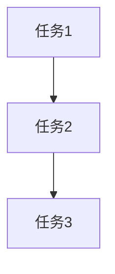
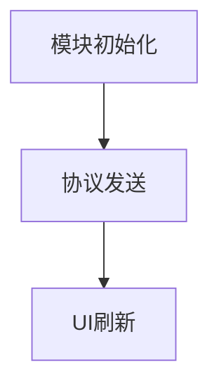

# tasks/client-implementation.md 生成规则（精简版 v2）

> **说明**: 本文档定义客户端实施任务（tasks/*.md）的生成规则。
> 
> **设计哲学**: 规则文件只包含"任务拆分的质量标准"，所有代码模板通过 CodeGraph 查询获取。

---

## 0. 代码规范（强制）

**生成客户端 C# 代码前，必须阅读并遵守项目编码规范：**

规范入口（相对于客户端工程根目录）：
```
docs/ai-core/rules/coding_standards/README.md
```

**必读文件清单**（相对 `docs/ai-core/rules/coding_standards/`，以各原文件为准）：
- `csharp_spec.md` — 基础编码规范（如 `m_` 前缀、类内成员排列顺序、数据结构类的公有变量原则等）
- `csharp_safe.md` — 保护规范（如判空、越界、生命周期管理）
- `csharp_gc.md` — GC 优化规则（如避免 foreach 装箱、慎用 LINQ、字符串拼接用 StringBuilder 等）
- `csharp_comment.md` — 注释规范（尤其 UI 面板 `OnOpen` 参数注释）
- `csharp_self.md` — 个人代码风格（参数命名、partial 拆分、模块门面、Define 等）
- 通用 UI/逻辑要求见 `csharp_func_dev.md`

**关键规则摘要（详细规则以原文件为准）：**
1. **命名约定**：
   - 私有/保护成员变量：`m_` 前缀，首字母大写（如 `m_SkillID`）
   - 静态成员变量：`s_` 前缀，首字母大写（如 `s_CacheItemList`）
   - 常量：全大写下划线分隔（如 `INVALID_REQUEST_ID`）
   - 公共属性/成员：首字母小写（如 `skillID`）
   - 类/函数/枚举：大小混排，首字母大写（如 `GrowthFundModule`、`RequestBuyGrowthFund()`）

2. **类内成员排列顺序（必须严格遵守）**：
   ```
   私有成员变量 → 保护成员变量 → 公共成员变量 → 公共属性接口 →
   公共函数 → 保护函数 → Unity系统回调函数 → 自定义回调函数 → 私有函数
   ```

3. **数据结构类原则**：
   纯数据类（只承载存储，无或极少函数）可使用公有成员变量；
   逻辑类必须使用私有成员变量 + 公共属性接口。

4. **不要猜测 API**：
   - 生成代码前，先用 `codegraph explore` 或 `grep` 查找项目中现有的真实 API 调用点。
   - 禁止根据"常识"猜测静态方法/扩展方法的存在（如 `ItemGroup.Parse()`、泛型 `GetOrAllocate<T>()`）。
   - 优先查找同模块/同类型的其他文件作为模板（如实现 `XXXModule` 时先查 `AccumulateModule`、`ActivityDrawKOIModule` 等）。

5. **编译后验证**：
   生成代码后，立即运行 `dotnet build` 检查编译错误（详见后续"编译验证"章节）。

6. **UI 文本组件强制使用 TextMeshPro**：
   - ❌ 禁止使用 Unity 原生的 `Text` 组件（`UnityEngine.UI.Text`）
   - ✅ 必须使用 `TextMeshProUGUI`（命名空间 `TMPro`）
   - 变量命名：`m_TxtTitle`（Text 前缀 + 大小混排）
   - 类型声明：`TextMeshProUGUI m_TxtTitle;`
   - 原因：项目已全面迁移到 TextMeshPro，使用旧 Text 组件会导致字体/排版不一致

**违反规范的后果**：
- 编译错误（如 CS0117、CS1061、CS0308 等）— 通常是猜测了不存在的 API
- 代码审查不通过 — 命名/排列顺序不符合项目约定
- 运行时 GC 压力 — 未遵守 GC 优化规则

**何时查规范**：
- ✅ 每次生成新的 C# 文件前，重新确认命名约定和排列顺序
- ✅ 遇到编译错误时，先 grep 真实 API 用法，再修复
- ✅ 实现涉及循环/字符串拼接/集合操作的代码时，检查 GC 优化规则

---

## 0.1 配置表代码生成规范（强制）

**禁止手写配置表 CS 代码**，必须通过工具生成。

### 配置表代码生成流程

**步骤 1：注册配置表名**
- 文件：`..\develop\client\tools\table\table_config\outcode_config.json`
- 在 `need_copy` 数组中添加表名（不含 `.txt` 后缀，小写+下划线格式）
- 示例：`"active_fund_main"`, `"activity_mix_growthfund_reward"`

**步骤 2：检查是否需要 NeedParseDataMethod 配置**
- 如果配置表字段属性为 **纯S（Server only）** 且用于活动系统，需额外配置
- 在 `NeedParseDataMethod` 数组中添加同样的表名
- **判断依据**：查看 `design/config.md` 中字段定义表的"属性"列
  - 所有字段都标记为 S → 需要添加到 `NeedParseDataMethod`
  - 有任何字段标记为 C 或 A → 不需要添加

**步骤 3：生成代码**
- 双击运行 `..\develop\client\tools\table\output_code_csharp.bat`
- 自动生成 4 个文件：
  - `Assets/Script/Table/Generate/Activity/{TableName}/TD{TableName}.cs` （数据类）
  - `Assets/Script/Table/Generate/Activity/{TableName}/TD{TableName}Table.cs` （表管理类）
  - `Assets/Script/Table/Extend/Activity/{TableName}/TD{TableName}Extend.cs` （数据扩展，首次生成空实现）
  - `Assets/Script/Table/Extend/Activity/{TableName}/TD{TableName}TableExtend.cs` （表扩展，含动态加载逻辑）

**步骤 4：验证生成结果**
- 检查 Generate 目录下的文件是否包含所有字段（对比 design/config.md 的字段定义）
- 检查字段类型是否正确（int/string/float）
- 检查 `ParseData` 方法是否正确解析每个字段

**违反规范的后果**：
- 手写配置表代码可能遗漏字段、类型不匹配、`ParseData` 逻辑错误
- 后续策划修改配置表字段时，手写代码不会自动同步，导致运行时解析失败

---

### ⚠️ 配置表接入 DynamicConfigModule 有两级注册，任务清单必须各出一条任务（阻断性）

**背景**：步骤 1-4（`outcode_config.json` + `output_code_csharp.bat` + `TDXxxTableExtend.cs` + `DynamicConfigModule_Process.cs::RegisterTable`）只完成了**表级注册**——让框架认得这张表怎么解析。这一步做完后编译能通过，`TDXxxTable` 类也存在，很容易被误判为"已经接入完成"。

**但表级注册之外还有活动级注册**：必须有某个业务 Module 实现 `IConfigSyncMethod` 接口，把这张表的表名放进它的 `fileNameList`，并在该 Module 的 `OnInit()` 里调用 `m_DynamicConfigModule.RegisterSyncMethod(this)`。这一步告诉框架"玩家打开这个活动时，需要主动去拉取这些表的数据"。**没有这一步，`TDXxxTable.GetData()` 永远返回空/默认值，且编译和运行时都不会报错**（因为查表接口本身是合法调用，只是数据从未被拉取过）。

**任务清单生成要求**：
- 凡是给活动模块（`XxxModule.cs`）新增了通过 `DynamicConfigModule` 整表同步的配置表，任务清单里必须包含一条独立任务，明确写出：
  1. `XxxModule` 声明实现 `IConfigSyncMethod`
  2. 在 `fileNameList`（或 `preFileNameList`，视是否需要提前加载而定）中列出新增的表名
  3. 在 `OnInit()` 中调用 `m_DynamicConfigModule.RegisterSyncMethod(this)`
- 不能把这一步隐含在"创建 XxxModule.cs 骨架"这类笼统任务描述里——必须单独列出，避免被漏掉（`RegisterTable` 任务完成后容易误以为"配表已经通了"就此止步）
- 代码模板查询：`codegraph explore "IConfigSyncMethod RegisterSyncMethod fileNameList"`，参考模块：`ActivityDrawKOIModule`、`MarblePlinkoModule`

**验证方式**：
- 编译通过（`XxxModule : ILogicModule, IConfigSyncMethod` 无缺失成员报错）
- 运行时打开该活动面板后，`TDXxxTable.GetData(id)` 能读到非默认值（而非表级注册验证只看"编译通过、类存在"）

---

## 0.2 UI 脚本注册规范（强制）

**继承 AbstractPage（或其子类如 BaseActivityPage）的 UI 脚本必须注册到 UIDataTable**。

### UI 注册流程

**步骤 1：添加 UIID 枚举**
- 文件：`..\develop\client\project\Assets\Script\Table\Data\Define\UIDefine.cs`
- 在 `enum UIID` 中添加新的 UI ID（按功能模块分组，插入到相似 UI 附近）
- 命名规则：UI 类名去掉 `.cs` 后缀，保持大小写一致
- 示例：
  ```csharp
  // 运营活动
  SpecialLoginActivityPage,          // 七日登陆活动(通用模板)
  ActivitySevenDayTaskPage,           // 七日任务活动
  ActivityDevelopPlanPage,            // 成长计划活动
  GrowthFundPage,                     // 成长基金活动（新增）
  ActivityDrawKOIPage,                // 锦鲤活动
  ```

**步骤 2：注册 UI 到 UIDataTable**
- 文件：`..\develop\client\project\Assets\Script\LogicModule\UIModule\Data\UIDataTable.cs`
- 在 `InitUIDataTable()` 方法中添加 `AddPanelData` 调用（按功能模块分组，插入到相似 UI 附近）
- API 格式：
  ```csharp
  AddPanelData(UIID.{UI类名}, typeof({UI类名}), "{Prefab相对路径}");
  ```
- Prefab 路径规则：
  - 只需要相对路径片段，不需要 `Assets/Prefab/UI/` 前缀和 `.prefab` 后缀
  - 一般按功能模块分目录：`"WelfareActivityPanel/GrowthFundPage"`
- 示例：
  ```csharp
  // 运营活动
  AddPanelData(UIID.SpecialLoginActivityPage, typeof(SpecialLoginActivityPage), "WelfareActivityPanel/SpecialLoginActivityPage");
  AddPanelData(UIID.ActivitySevenDayTaskPage, typeof(ActivitySevenDayTaskPage), "WelfareActivityPanel/ActivitySevenDayTaskPage");
  AddPanelData(UIID.ActivityDevelopPlanPage, typeof(ActivityDevelopPlanPage), "WelfareActivityPanel/ActivityDevelopPlanPage");
  AddPanelData(UIID.GrowthFundPage, typeof(GrowthFundPage), "WelfareActivityPanel/GrowthFundPage");
  ```

**步骤 3：验证注册**
- 编译通过（`UIID.GrowthFundPage` 和 `typeof(GrowthFundPage)` 无报错）
- 运行时通过 `UIModule.OpenPage(UIID.GrowthFundPage)` 能正常打开 UI

**违反规范的后果**：
- 未注册 UIID：`UIID.GrowthFundPage` 编译错误（CS0117）
- 未注册 UIDataTable：运行时调用 `OpenPage(UIID.GrowthFundPage)` 无反应或报空引用错误
- Prefab 路径错误：UI 能打开但显示为空或加载失败

---

## 一点五、前端架构设计强制要求（阻断性）

**生成客户端具体任务（4.1 及以后）前，必须先在 tasks.md 的"4.0 前端架构设计"章节填写完整的架构设计，不得留空或跳过。**

### 1.5.1 为什么需要

没有架构约束时，AI 直接从 design/client.md 的功能点跳到"创建 XxxModule.cs"这类具体任务，容易把 Record 监听、协议收发、UI 刷新全部堆进一个类，导致：
- 职责边界不清晰，后续维护成本高
- 评审者看不出设计意图，只能从代码反推
- 数据缓存位置随意，容易出现 Module 和 Page 各存一份、状态不一致

### 1.5.2 架构设计的知识来源（强制：知识库优先，不新写文档）

**本项目不维护独立的客户端架构知识库**，架构设计的依据来自客户端工程自己的知识库：

```
..\develop\client\project\docs\ai-core\README.md
```

**生成 4.0 章节前的强制步骤**：
1. 读取 `docs/ai-core/README.md` 入口，按任务进入 `knowledge/core-index.md`
2. 按 `knowledge/modules/index.md` 定位对应系统卡（活动类功能 → `activity-system.md`；纯面板展示 → `ui-management-system.md`；涉及配置表加载 → `table-loading-system.md`）
3. Read 命中的系统卡，取其中的模块分层、数据流和刷新链路作为架构依据
4. 编码规范另按本文 §0 读 `rules/coding_standards/README.md`
5. 用知识卡 + design.md 附录 A 的现场调查结论，填 4.0 的 5 个小节

**如果 modules/index.md 没有覆盖到的功能类型**（不是标准活动模式，如需要独立物理模拟的玩法）：
- 允许用 CodeGraph 查询代码现场分析架构（如 `codegraph explore "MarblePlinkoModule MarblePlinkoPage OnUpdateTime"`）
- 在 4.0.4 决策表里注明"知识库未覆盖，参考 XXX 模块现场分析"

### 1.5.3 架构设计章节结构（对应模板 tasks.md 的 4.0）

```markdown
### 4.0 前端架构设计

#### 4.0.1 模块分层与职责
- Module（数据层）：职责 + 不做什么
- Page（视图控制器）：职责 + 不做什么
- Cell（可复用组件）：职责 + 不做什么

#### 4.0.2 数据流设计
Server Record 更新 → Module 缓存/通知 → Page 订阅 → Cell 刷新 的完整链路

#### 4.0.3 状态管理策略
- 单一数据源在哪一层
- 缓存位置（Module 的 Dictionary，还是不缓存实时读）
- 刷新机制（事件驱动 CommandDelayArgsDynamic，还是轮询 OnUpdateTime）

#### 4.0.4 关键设计决策表
| 决策点 | 方案 | 理由 |
|-------|------|------|
| Record 监听位置 | Module / Page | 说明理由 |
| 数据缓存位置 | Module / Page / 不缓存 | 说明理由 |
| 协议发送位置 | Cell 调 Module / Page 直接发 | 说明理由 |
| 红点计算时机 | Record 回调 / Page 打开时 | 说明理由 |

#### 4.0.5 文件组织
XxxModule/ 和 XxxPage/ 目录下的文件清单及各自职责
```

### 1.5.4 推荐的标准三层架构（默认模式，除非知识库指出例外）

**参考实现**：`MixGrowthFundModule` + `MixGrowthFundPage`（客户端工程内真实代码，可直接 CodeGraph 查询）

- **Module 层**：持有数据缓存（`Dictionary<int, XxxStatus>`），在 Record 监听回调里刷新缓存并主动发事件通知（`m_Kernel.CommandDelayArgsDynamic`），提供只读查询方法给 Page 调用，不持有 UI 引用
- **Page 层**：`OnCreateUI` 获取 Module 引用，`InitCommand` 订阅 Module 发出的刷新事件，事件触发时调用 Module 的查询方法刷新 UI，不直接读 Record
- **Cell 层**：只做数据绑定和状态映射，不直接调协议，通过回调转发给 Page/Module 处理

**例外场景**（不适用三层缓存模式，参考知识库或 CodeGraph 现场分析）：
- 需要每帧/每秒轮询的实时玩法（如物理模拟类），参考 `MarblePlinkoModule` 模式
- 纯展示无后端数据的界面，不需要 Module 层

**CodeGraph 查询模板**：
```bash
codegraph explore "MixGrowthFundModule IConfigSyncMethod OnRecordChanged GetRewardStatus"
codegraph explore "MixGrowthFundPage InitCommand OnMixGrowthFundRefresh RefreshView"
```

---

## 一、任务拆分粒度规则

### 1.1 粒度标准（阻断性）

**合格的任务粒度**：

| 标准 | 要求 | 检查方式 |
|-----|------|---------|
| **实现时间** | 30 分钟 ~ 2 小时 | 估算单个任务的代码量 |
| **代码行数** | 50 ~ 200 行 | 统计任务涉及的代码行数 |
| **独立验证** | 可独立运行验证 | 任务完成后能否单独测试 |
| **单一职责** | 只做一件事 | 任务描述是否包含"和""以及" |

---

### 1.2 禁止的任务类型（阻断性）

❌ **过于宽泛**：
- "实现 XXXModule 全部功能"
- "完成 UI 开发"
- "实现客户端逻辑"

❌ **过于细碎**：
- "定义 XXX 变量"
- "添加 using 语句"
- "修改缩进"

---

### 1.3 合格的任务示例

✅ **模块初始化**：
```
任务：实现 GrowthFundModule 初始化
内容：获取依赖模块、注册协议回调、注册红点回调
估算：1 小时，约 80 行代码
验证：模块加载无报错，协议回调能触发
```

✅ **协议发送**：
```
任务：实现购买请求协议发送
内容：构造 C2S_GROWTH_FUND_PURCHASE 协议参数，调用 Custom 发送
估算：30 分钟，约 50 行代码
验证：抓包看到协议发送，参数正确
```

✅ **UI 刷新**：
```
任务：实现 UI Panel 的奖励列表刷新逻辑
内容：监听 Record 变化，刷新列表 UI，更新按钮状态
估算：1.5 小时，约 150 行代码
验证：修改 Record 数据，UI 自动刷新
```

---

## 二、任务生成指南

### 2.1 从 design 文档生成任务

**生成流程**：
```
读取 design/client.md 的"关键功能说明"章节
  ↓
每个功能拆分为 1-3 个任务
  ↓
每个任务包含：文件路径、实现内容、代码模板查询、验证方式
```

**示例**（基于 design 文档的"模块初始化"功能）：
```markdown
### 任务 1：实现 GrowthFundModule 初始化

**文件**: `Assets/Script/LogicModule/GrowthFundModule/GrowthFundModule.cs`

**实现内容**:
- 获取依赖模块（BusinessActivityModule、RedPointModule）
- 注册协议回调（C2S_GROWTH_FUND_PURCHASE、C2S_GROWTH_FUND_CLAIM）
- 注册红点回调（RegisterRedPointCallback）

**代码模板获取**:
```
CodeGraph 查询：LogicModule OnInit 协议注册 红点注册
参考模块：AccumulateModule, GrowthFundModule（若已存在）
```

**验证方式**:
- 运行客户端，检查模块加载无报错
- 触发购买操作，检查协议回调能正常触发
```

---

### 2.2 任务文件结构

```markdown
# Tasks: {功能名称} - Client

## 任务列表

### 任务 1：{任务名称}
**文件**: {文件路径}
**实现内容**: {箭头列表}
**代码模板获取**: {CodeGraph 查询}
**验证方式**: {验证步骤}

### 任务 2：{任务名称}
（重复上述结构）

## 任务依赖关系



## 验收标准

- [ ] 所有任务完成
- [ ] 代码编译通过
- [ ] 功能验证通过（见各任务验证方式）
- [ ] 代码审查通过
```

---

## 三、特殊任务类型

### 3.1 配置任务（修改配置文件）

**标注方式**：
```markdown
### 任务 X：在 TableConfig.cs 中注册新配置表

**任务类型**: ⚠️ 配置任务（修改配置文件）

**文件**: `Assets/Script/Table/TableConfig.cs`

**修改内容**:
在 `delayLoadTableArray` 数组中添加：
```csharp
TDGrowthFundTable.metaData,
```

**验证方式**:
- 运行客户端，检查配置表能正常加载
```

---

### 3.2 配置表代码生成任务（自动执行）

**说明**：`output_code_csharp.bat` 是无交互的批处理脚本，可直接通过 Bash 工具调用执行，无需人工介入。

**标注方式**：
```markdown
### 任务 X：运行 output_code_csharp.bat 生成配置表代码

**目标路径**: ../develop/client/tools/table/

**依赖**: 任务 Y（outcode_config.json 已添加表名）

**操作步骤**: 运行 output_code_csharp.bat，生成 TDXxx.cs / TDXxxTable.cs 及对应 Extend.cs 文件

**验证方式**:
- 生成的文件无编译错误
- ParseData 方法字段与 design.md 附录 C 一致
```

**注意**: 此任务不标记为"手工任务"，执行时直接调用 `output_code_csharp.bat` 并检查生成结果。

---

## 四、代码模板查询指南

所有代码模板通过 CodeGraph 查询获取，不在规则文件中硬编码。

### 4.1 模块相关

| 任务类型 | CodeGraph 查询 | 参考模块 |
|---------|---------------|---------|
| 模块初始化 | `LogicModule OnInit 协议注册` | AccumulateModule |
| 依赖模块获取 | `GetModule BusinessActivityModule` | - |
| 事件注册 | `AddEventHook OnMainPlayerReady` | - |

---

### 4.2 协议相关

| 任务类型 | CodeGraph 查询 | 参考模块 |
|---------|---------------|---------|
| 协议发送 | `Custom CLIENT_CUSTOMMSG IVarList` | - |
| 协议接收 | `AddCustomHook SERVER_CUSTOMMSG` | - |

---

### 4.3 UI 相关

| 任务类型 | CodeGraph 查询 | 参考模块 | 特别注意 |
|---------|---------------|---------|---------|
| Panel 结构 | `AbstractPanel OnOpen OnClose` | - | UI 文本必须用 TextMeshProUGUI（变量名 `m_TxtXxx`），禁用 UnityEngine.UI.Text |
| 列表刷新 | `OnCellUpdated Transform index` | - | - |
| 文本赋值 | `TextMeshProUGUI.text` | - | 引用命名空间 `using TMPro;` |

#### 4.3.1 动态组件容器（*-root 类组件）

**适用场景**：demo 中使用 `data-component="content.item-icon-root"` 或 `content.buff-icon-root` 等动态容器组件时

| 容器类型 | 字段类型约束 | 运行时 API | 数据解析 | 点击行为模式 | 参考案例 |
|---------|------------|-----------|---------|-------------|---------|
| content.item-icon-root | Transform | UIHelper.GetOrAllocate<ItemIconBase>(m_Root) | rewardStr.ToItemGroup() | 状态驱动：可操作→业务回调，不可操作→OpenItemTips | MixGrowthFundRewardCell.cs |
| content.buff-icon-root | Transform | BuffIcon.Allocate(m_Root) | - | 静态显示，无点击 | - |

**ItemIconBase 标准使用模板**：

```csharp
// 1. 字段声明（Prefab 生成器已自动绑定 Transform 字段）
[SerializeField] Transform m_ItemIconRoot;
ItemIconBase m_ItemIcon;  // 缓存组件引用

// 2. 运行时动态创建并设置数据
void SetData(string rewardStr, CellClaimState state, System.Action onClaim)
{
    // 解析奖励串（格式: "itemID:count"，如 "1003:188"）
    ItemGroup item = rewardStr.ToItemGroup();
    
    // 从对象池获取/创建 ItemIconBase（禁止 new ItemIconBase()）
    m_ItemIcon = UIHelper.GetOrAllocate(m_ItemIconRoot);
    m_ItemIcon.SetInfo(item.itemID, item.count);
    
    // 3. 根据业务状态设置点击行为（状态驱动模式）
    if (state == CellClaimState.Claimable)
    {
        // 可操作状态：触发业务回调（如领奖、购买）
        m_ItemIcon.onClick = (ItemIconBase icon) => {
            onClaim?.Invoke();
        };
    }
    else
    {
        // 不可操作/已完成状态：查看道具详情
        m_ItemIcon.onClick = (ItemIconBase icon) => {
            BagHelper.OpenItemTips(null, icon.configID, false, null, AlignAdjuster.AlignType.Auto);
        };
    }
}
```

**常见错误（阻断性）**：
- ❌ 字段类型写成 `GameObject` 或 `ItemIconBase`（**必须是 `Transform` 或 `RectTransform`**）
- ❌ 忘记根据状态切换 `onClick` 回调（导致已领取还能重复触发业务逻辑）
- ❌ 使用 `new ItemIconBase()` 直接实例化（**必须用 `UIHelper.GetOrAllocate` 从对象池获取**）
- ❌ 未引用 `using SoulEngine;`（`UIHelper` 在此命名空间）

**判断是否需要状态驱动模式**：
- ✅ 需要：奖励格子（可领取/已领取）、商品格子（可购买/已购买）、任务格子（可完成/已完成）
- ❌ 不需要：纯展示的道具列表、背包格子（点击只查看详情）

---

### 4.4 红点相关

| 任务类型 | CodeGraph 查询 | 参考模块 |
|---------|---------------|---------|
| 红点注册 | `RegisterRedPointCallback BusinessActivityType` | BusinessActivityModule_RedPoint.cs |
| 红点刷新 | `DirtyRedPoint` | - |

---

### 4.5 配置表相关（重要）

**⚠️ 配置表代码必须通过工具生成，禁止手写**

| 任务类型 | 前置检查 | 操作步骤 |
|---------|---------|---------|
| 生成配置表代码 | 1. 确认 design/config.md 已标注字段 S/C/A 属性<br>2. 确认 design/config.md 已标注配置加载方式（静态/动态）<br>3. 确认 design/config.md 已给出 outcode_config.json 配置建议 | 1. 修改 `outcode_config.json` 添加表名<br>2. 运行 `output_code_csharp.bat` 生成代码<br>3. 验证生成的文件字段完整性 |

**配置前置检查详细步骤**：

1. **检查 design/config.md 是否完整**：
   ```bash
   # 检查字段属性列是否标注（S/C/A）
   grep "属性.*S/C/A" design/config.md
   
   # 检查 outcode_config 配置建议是否存在
   grep "outcode_config.json 配置建议" design/config.md
   ```

2. **根据 design/config.md 的建议修改 outcode_config.json**：
   - 文件位置：`..\develop\client\tools\table\table_config\outcode_config.json`
   - 如果包含 C 或 A 字段 → 添加到 `need_copy` 数组
   - 如果是动态活动配置 → 添加到 `NeedParseDataMethod` 数组

3. **生成代码**：
   ```bash
   cd ..\develop\client\tools\table
   双击 output_code_csharp.bat
   ```

4. **验证生成结果**：
   - 检查 `Assets/Script/Table/Generate/{模块}/{表名}/` 下是否生成 4 个文件
   - 对比生成的字段列表与 design/config.md 是否一致
   - 运行 `dotnet build` 检查是否有编译错误

**常见错误**：
- ❌ 手写配置表代码 → 字段遗漏、类型不匹配、ParseData 逻辑错误
- ❌ 未检查 design/config.md → 不知道应该配置 need_copy 还是 NeedParseDataMethod
- ❌ 配置表名拼写错误 → bat 脚本找不到对应的 xlsx 文件，生成失败

**CodeGraph 查询参考**（用于验证生成结果）：
```
# 查询现有配置表的结构
TDActivityKoiReward ParseData activeId rewardId

# 查询配置表的访问方式
TDActivityKoiRewardTable GetData InsertDynamicData
```

---

## 五、常见问题 FAQ

### Q1: 如何判断任务拆分是否合理？

**A**: 检查以下标准：
- 任务描述是否清晰（无"等""以及"等模糊词）
- 任务是否可独立验证（不依赖其他任务完成）
- 任务是否符合粒度标准（30 分钟 ~ 2 小时）

---

### Q2: 如果任务过大怎么办？

**A**: 按职责拆分：
- 过大任务："实现 XXXModule 全部功能"
- 拆分后：
  - 任务 1：实现 XXXModule 初始化
  - 任务 2：实现协议发送
  - 任务 3：实现 UI 刷新逻辑

---

### Q3: 如何处理任务依赖？

**A**: 在"任务依赖关系"章节使用 Mermaid 图标注依赖：


---

**版本**: v2 (精简版)  
**最后更新**: 2026-07-22  
**维护原则**: 只包含"任务拆分的质量标准"，代码模板通过 CodeGraph 查询
