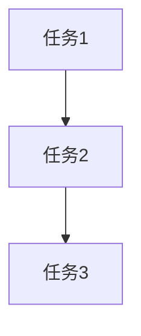
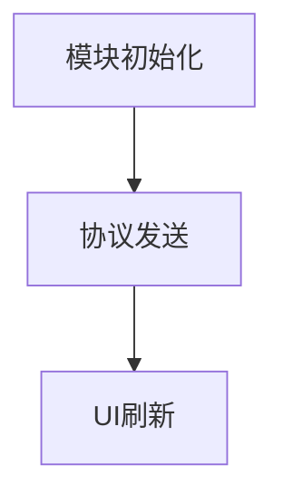

# tasks/client-implementation.md 生成规则（精简版 v2）

> **说明**: 本文档定义客户端实施任务（tasks/*.md）的生成规则。
> 
> **设计哲学**: 规则文件只包含"任务拆分的质量标准"，所有代码模板通过 CodeGraph 查询获取。

---

## 0. 代码规范（强制）

**生成客户端 C# 代码前，必须阅读并遵守项目编码规范：**

规范文件目录（相对于客户端工程根目录）：
```
.claude/skills/common/csharp_code/
```

**必读文件清单：**
- `csharp_spec.md` — 33 条具体命名/格式/结构规则（如 `m_` 前缀、类内成员排列顺序、数据结构类的公有变量原则等）
- `csharp_gc.md` — GC 优化规则（如避免 foreach 装箱、慎用 LINQ、字符串拼接用 StringBuilder 等）
- `csharp_safe.md` — 安全编码规则（如判空、生命周期管理、避免野指针等）

**关键规则摘要（详细规则以原文件为准）：**
1. **命名约定**：
   - 私有/保护成员变量：`m_` 前缀，首字母大写（如 `m_SkillID`）
   - 静态成员变量：`s_` 前缀，首字母大写（如 `s_CacheItemList`）
   - 常量：全大写下划线分隔（如 `INVALID_REQUEST_ID`）
   - 公共属性/成员：首字母小写（如 `skillID`）
   - 类/函数/枚举：大小混排，首字母大写（如 `GrowthFundModule`、`RequestBuyGrowthFund()`）

2. **类内成员排列顺序（必须严格遵守）**：
   ```
   私有成员变量 → 保护成员变量 → 公共成员变量 → 公共属性接口 →
   公共函数 → 保护函数 → Unity系统回调函数 → 自定义回调函数 → 私有函数
   ```

3. **数据结构类原则**：
   纯数据类（只承载存储，无或极少函数）可使用公有成员变量；
   逻辑类必须使用私有成员变量 + 公共属性接口。

4. **不要猜测 API**：
   - 生成代码前，先用 `codegraph explore` 或 `grep` 查找项目中现有的真实 API 调用点。
   - 禁止根据"常识"猜测静态方法/扩展方法的存在（如 `ItemGroup.Parse()`、泛型 `GetOrAllocate<T>()`）。
   - 优先查找同模块/同类型的其他文件作为模板（如实现 `XXXModule` 时先查 `AccumulateModule`、`ActivityDrawKOIModule` 等）。

5. **编译后验证**：
   生成代码后，立即运行 `dotnet build` 检查编译错误（详见后续"编译验证"章节）。

6. **UI 文本组件强制使用 TextMeshPro**：
   - ❌ 禁止使用 Unity 原生的 `Text` 组件（`UnityEngine.UI.Text`）
   - ✅ 必须使用 `TextMeshProUGUI`（命名空间 `TMPro`）
   - 变量命名：`m_TxtTitle`（Text 前缀 + 大小混排）
   - 类型声明：`TextMeshProUGUI m_TxtTitle;`
   - 原因：项目已全面迁移到 TextMeshPro，使用旧 Text 组件会导致字体/排版不一致

**违反规范的后果**：
- 编译错误（如 CS0117、CS1061、CS0308 等）— 通常是猜测了不存在的 API
- 代码审查不通过 — 命名/排列顺序不符合项目约定
- 运行时 GC 压力 — 未遵守 GC 优化规则

**何时查规范**：
- ✅ 每次生成新的 C# 文件前，重新确认命名约定和排列顺序
- ✅ 遇到编译错误时，先 grep 真实 API 用法，再修复
- ✅ 实现涉及循环/字符串拼接/集合操作的代码时，检查 GC 优化规则

---

## 一、任务拆分粒度规则

### 1.1 粒度标准（阻断性）

**合格的任务粒度**：

| 标准 | 要求 | 检查方式 |
|-----|------|---------|
| **实现时间** | 30 分钟 ~ 2 小时 | 估算单个任务的代码量 |
| **代码行数** | 50 ~ 200 行 | 统计任务涉及的代码行数 |
| **独立验证** | 可独立运行验证 | 任务完成后能否单独测试 |
| **单一职责** | 只做一件事 | 任务描述是否包含"和""以及" |

---

### 1.2 禁止的任务类型（阻断性）

❌ **过于宽泛**：
- "实现 XXXModule 全部功能"
- "完成 UI 开发"
- "实现客户端逻辑"

❌ **过于细碎**：
- "定义 XXX 变量"
- "添加 using 语句"
- "修改缩进"

---

### 1.3 合格的任务示例

✅ **模块初始化**：
```
任务：实现 GrowthFundModule 初始化
内容：获取依赖模块、注册协议回调、注册红点回调
估算：1 小时，约 80 行代码
验证：模块加载无报错，协议回调能触发
```

✅ **协议发送**：
```
任务：实现购买请求协议发送
内容：构造 C2S_GROWTH_FUND_PURCHASE 协议参数，调用 Custom 发送
估算：30 分钟，约 50 行代码
验证：抓包看到协议发送，参数正确
```

✅ **UI 刷新**：
```
任务：实现 UI Panel 的奖励列表刷新逻辑
内容：监听 Record 变化，刷新列表 UI，更新按钮状态
估算：1.5 小时，约 150 行代码
验证：修改 Record 数据，UI 自动刷新
```

---

## 二、任务生成指南

### 2.1 从 design 文档生成任务

**生成流程**：
```
读取 design/client.md 的"关键功能说明"章节
  ↓
每个功能拆分为 1-3 个任务
  ↓
每个任务包含：文件路径、实现内容、代码模板查询、验证方式
```

**示例**（基于 design 文档的"模块初始化"功能）：
```markdown
### 任务 1：实现 GrowthFundModule 初始化

**文件**: `Assets/Script/LogicModule/GrowthFundModule/GrowthFundModule.cs`

**实现内容**:
- 获取依赖模块（BusinessActivityModule、RedPointModule）
- 注册协议回调（C2S_GROWTH_FUND_PURCHASE、C2S_GROWTH_FUND_CLAIM）
- 注册红点回调（RegisterRedPointCallback）

**代码模板获取**:
```
CodeGraph 查询：LogicModule OnInit 协议注册 红点注册
参考模块：AccumulateModule, GrowthFundModule（若已存在）
```

**验证方式**:
- 运行客户端，检查模块加载无报错
- 触发购买操作，检查协议回调能正常触发
```

---

### 2.2 任务文件结构

```markdown
# Tasks: {功能名称} - Client

## 任务列表

### 任务 1：{任务名称}
**文件**: {文件路径}
**实现内容**: {箭头列表}
**代码模板获取**: {CodeGraph 查询}
**验证方式**: {验证步骤}

### 任务 2：{任务名称}
（重复上述结构）

## 任务依赖关系



## 验收标准

- [ ] 所有任务完成
- [ ] 代码编译通过
- [ ] 功能验证通过（见各任务验证方式）
- [ ] 代码审查通过
```

---

## 三、特殊任务类型

### 3.1 手工任务（非代码实现）

**标注方式**：
```markdown
### 任务 X：运行 output_code_csharp.bat 生成配置表代码

**任务类型**: ⚠️ 手工任务（非代码实现）

**操作步骤**:
1. 打开终端，进入 `D:\se\develop\client\tools\table\`
2. 执行 `output_code_csharp.bat`
3. 检查 `Assets/Script/Table/Data/` 下是否生成 `TDGrowthFundTable.cs`

**验证方式**:
- 生成的文件无编译错误
```

---

### 3.2 配置任务（修改配置文件）

**标注方式**：
```markdown
### 任务 X：在 TableConfig.cs 中注册新配置表

**任务类型**: ⚠️ 配置任务（修改配置文件）

**文件**: `Assets/Script/Table/TableConfig.cs`

**修改内容**:
在 `delayLoadTableArray` 数组中添加：
```csharp
TDGrowthFundTable.metaData,
```

**验证方式**:
- 运行客户端，检查配置表能正常加载
```

---

## 四、代码模板查询指南

所有代码模板通过 CodeGraph 查询获取，不在规则文件中硬编码。

### 4.1 模块相关

| 任务类型 | CodeGraph 查询 | 参考模块 |
|---------|---------------|---------|
| 模块初始化 | `LogicModule OnInit 协议注册` | AccumulateModule |
| 依赖模块获取 | `GetModule BusinessActivityModule` | - |
| 事件注册 | `AddEventHook OnMainPlayerReady` | - |

---

### 4.2 协议相关

| 任务类型 | CodeGraph 查询 | 参考模块 |
|---------|---------------|---------|
| 协议发送 | `Custom CLIENT_CUSTOMMSG IVarList` | - |
| 协议接收 | `AddCustomHook SERVER_CUSTOMMSG` | - |

---

### 4.3 UI 相关

| 任务类型 | CodeGraph 查询 | 参考模块 | 特别注意 |
|---------|---------------|---------|---------|
| Panel 结构 | `AbstractPanel OnOpen OnClose` | - | UI 文本必须用 TextMeshProUGUI（变量名 `m_TxtXxx`），禁用 UnityEngine.UI.Text |
| 列表刷新 | `OnCellUpdated Transform index` | - | - |
| 文本赋值 | `TextMeshProUGUI.text` | - | 引用命名空间 `using TMPro;` |

---

### 4.4 红点相关

| 任务类型 | CodeGraph 查询 | 参考模块 |
|---------|---------------|---------|
| 红点注册 | `RegisterRedPointCallback BusinessActivityType` | BusinessActivityModule_RedPoint.cs |
| 红点刷新 | `DirtyRedPoint` | - |

---

## 五、常见问题 FAQ

### Q1: 如何判断任务拆分是否合理？

**A**: 检查以下标准：
- 任务描述是否清晰（无"等""以及"等模糊词）
- 任务是否可独立验证（不依赖其他任务完成）
- 任务是否符合粒度标准（30 分钟 ~ 2 小时）

---

### Q2: 如果任务过大怎么办？

**A**: 按职责拆分：
- 过大任务："实现 XXXModule 全部功能"
- 拆分后：
  - 任务 1：实现 XXXModule 初始化
  - 任务 2：实现协议发送
  - 任务 3：实现 UI 刷新逻辑

---

### Q3: 如何处理任务依赖？

**A**: 在"任务依赖关系"章节使用 Mermaid 图标注依赖：


---

**版本**: v2 (精简版)  
**最后更新**: 2026-07-22  
**维护原则**: 只包含"任务拆分的质量标准"，代码模板通过 CodeGraph 查询
