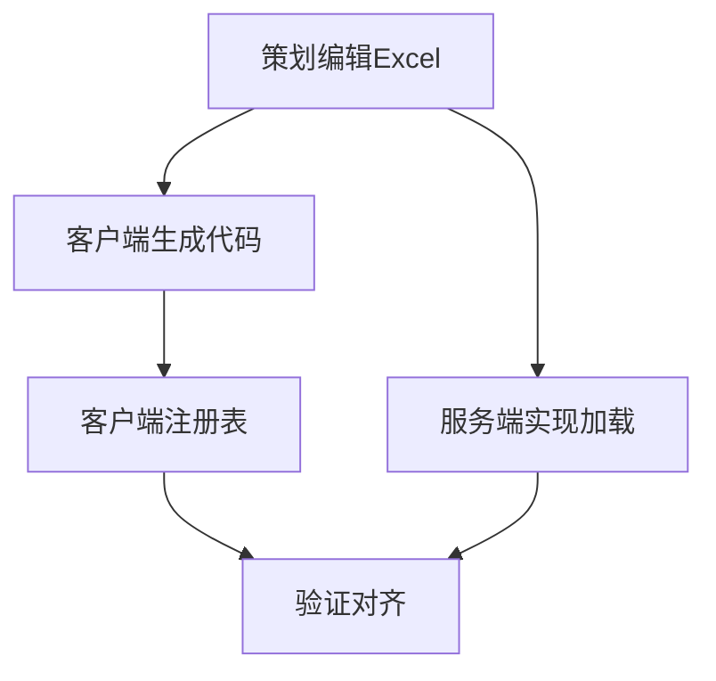

# tasks/config-implementation.md 生成规则（精简版 v2）

> **说明**: 本文档定义配置表实施任务（tasks/*.md）的生成规则。
> 
> **设计哲学**: 规则文件只包含"任务拆分的质量标准"，配置表任务有固定粒度。

---

## 一、配置表任务固定粒度

配置表任务与代码实现不同，有**固定的任务粒度**。

### 1.1 标准任务流程

```
任务 1：策划编辑 Excel 配置表（手工任务）
  ↓
任务 2：导出 txt 文件（自动化任务）
  ↓
任务 3：客户端生成 C# 代码（手工任务）
  ↓
任务 4：服务端实现配置加载（代码任务）
  ↓
任务 5：验证配置表对齐（验证任务）
```

---

### 1.2 禁止的任务拆分（阻断性）

❌ **过于细碎**（配置表不应该拆分成逐字段填写）：
- "填写 ActiveId 字段"
- "填写 Name 字段"
- "填写第 1 列"

❌ **过于宽泛**（配置表有固定流程，不应该合并）：
- "完成配置表开发"（应该拆分为编辑 Excel、生成代码、实现加载）

---

## 二、任务生成指南

### 2.1 从 design 文档生成任务

**生成流程**：
```
读取 design/config.md 的"配置表定义"章节
  ↓
为每个新增或修改的配置表生成固定流程任务
  ↓
每个任务包含：任务类型、操作步骤、验证方式
```

---

### 2.2 任务模板（新增配置表）

```markdown
### 任务 1：策划编辑 Excel 配置表

**任务类型**: ⚠️ 手工任务（策划执行）

**文件**: `../design/table/default_ios/active_growthfund_main.xlsx`

**操作步骤**:
1. 在策划配置目录创建 `active_growthfund_main.xlsx`
2. 定义表头（参考 design/config.md 的字段定义）
3. 填写示例数据（至少 2 行）
4. 保存文件，自动导出为 txt

**验证方式**:
- 检查 `active_growthfund_main.txt` 已生成
- txt 文件内容与 Excel 一致

---

### 任务 2：客户端生成 C# 解析代码

**任务类型**: ⚠️ 手工任务（客户端工程师执行）

**操作步骤**:
1. 打开终端，进入 `..\develop\client\tools\table\`
2. 执行 `output_code_csharp.bat`
3. 检查 `Assets/Script/Table/Data/TDActive_growthfund_mainTable.cs` 已生成

**验证方式**:
- 生成的文件无编译错误
- 字段类型与 design/config.md 一致

---

### 任务 3：在 TableConfig.cs 中注册新表

**任务类型**: ⚠️ 配置任务（客户端工程师执行）

**文件**: `Assets/Script/Table/TableConfig.cs`

**修改内容**:
在 `delayLoadTableArray` 数组中添加：
```csharp
TDActive_growthfund_mainTable.metaData,
```

**验证方式**:
- 运行客户端，检查配置表能正常加载
- 日志无 "Table not registered" 错误

---

### 任务 4：服务端实现配置加载

**任务类型**: 💻 代码任务（服务端工程师执行）

**文件**: `FsGame/ActivityModule/GrowthFundModule/GrowthFundModule.h` 和 `.cpp`

**实现内容**:
- 在 `.h` 中定义 `STGrowthFundMainConfig` 结构体
- 在 `.cpp` 中实现 `LoadGrowthFundMainConfig()` 函数
- 在 `Init()` 中调用加载函数

**代码模板获取**:
```
CodeGraph 查询：READ_FILE LoadResource txt.ReadInt 配置加载
参考模块：AccrueRechargeModule, CardModule
```

**验证方式**:
- 服务器启动时配置加载成功
- 日志无配置解析错误
- 使用 GM 命令查询配置数据，返回正确

---

### 任务 5：验证配置表对齐

**任务类型**: ✅ 验证任务（联合验证）

**验证内容**:
- 客户端和服务端字段顺序一致
- 客户端和服务端数据类型一致
- 客户端 `TDActive_growthfund_mainTable.GetData(1001)` 返回正确
- 服务端查询配置返回正确

**验证方式**:
1. 客户端运行，查询配置表数据
2. 服务器运行，使用 GM 命令查询配置
3. 对比两端数据是否一致
```

---

### 2.3 任务模板（扩展现有配置表）

```markdown
### 任务 1：策划在现有 Excel 中添加字段

**任务类型**: ⚠️ 手工任务（策划执行）

**文件**: `../design/table/default_ios/business_activity_maintimelist.xlsx`

**操作步骤**:
1. 打开现有 Excel 文件
2. 在表头添加新列：`ShowRemainTime` (int)
3. 为现有数据行填写该字段值
4. 保存文件，自动导出为 txt

**验证方式**:
- txt 文件包含新字段
- 新字段值正确

---

### 任务 2：客户端重新生成 C# 代码

（同新增配置表的任务 2）

---

### 任务 3：服务端修改配置结构体和加载逻辑

**任务类型**: 💻 代码任务（服务端工程师执行）

**文件**: `FsGame/ActivityModule/BusinessActivityModule/BizActivDefine.h` 和加载函数

**修改内容**:
- 在配置结构体中添加 `int nShowRemainTime;`
- 在加载函数中添加 `cfg.nShowRemainTime = txt.ReadInt(i, "ShowRemainTime");`

**验证方式**:
- 服务器启动时配置加载成功
- 新字段值正确读取

---

### 任务 4：验证配置表对齐

（同新增配置表的任务 5）
```

---

## 三、任务文件结构

```markdown
# Tasks: {功能名称} - Config

## 任务列表

（按固定流程生成任务）

## 任务依赖关系



## 验收标准

- [ ] 所有配置表任务完成
- [ ] 客户端配置表加载无报错
- [ ] 服务端配置表加载无报错
- [ ] 配置表对齐验证通过
```

---

## 四、常见问题 FAQ

### Q1: 为什么配置表任务有固定粒度？

**A**: 配置表任务涉及跨角色协作（策划、客户端、服务端），有固定的工作流程，不应该拆分或合并。

---

### Q2: 如果一次新增多个配置表怎么办？

**A**: 为每个配置表生成一套独立的任务流程（任务 1-5），在"任务依赖关系"中标注并行执行。

---

### Q3: 如何验证配置表对齐？

**A**: 
1. 客户端运行，查询配置表数据
2. 服务器运行，使用 GM 命令查询配置
3. 对比字段顺序、类型、值是否一致

---

**版本**: v2 (精简版)  
**最后更新**: 2026-07-22  
**维护原则**: 只包含"任务拆分的质量标准"，配置表任务有固定粒度
