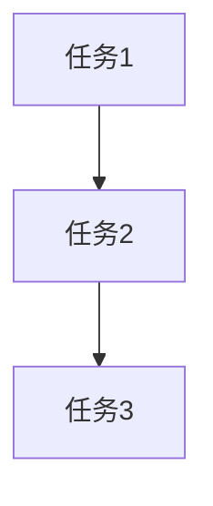
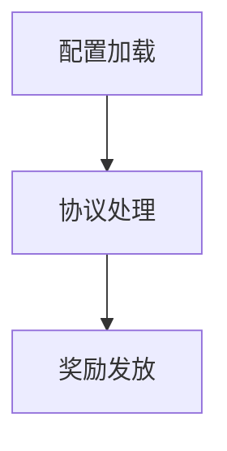

# tasks/server-implementation.md 生成规则（精简版 v2）

> **说明**: 本文档定义服务端实施任务（tasks/*.md）的生成规则。
> 
> **设计哲学**: 规则文件只包含"任务拆分的质量标准"，所有代码模板通过 CodeGraph 查询获取。

---

## 一、任务拆分粒度规则

### 1.1 粒度标准（阻断性）

**合格的任务粒度**：

| 标准 | 要求 | 检查方式 |
|-----|------|---------|
| **实现时间** | 30 分钟 ~ 2 小时 | 估算单个任务的代码量 |
| **代码行数** | 50 ~ 200 行 | 统计任务涉及的代码行数 |
| **独立验证** | 可独立运行验证 | 任务完成后能否单独测试 |
| **单一职责** | 只做一件事 | 任务描述是否包含"和""以及" |

---

### 1.2 禁止的任务类型（阻断性）

❌ **过于宽泛**：
- "实现 XXXModule 全部功能"
- "完成服务端逻辑"
- "实现数据库操作"

❌ **过于细碎**：
- "定义 XXX 变量"
- "添加 include 语句"

---

### 1.3 合格的任务示例

✅ **模块初始化**：
```
任务：实现 GrowthFundModule 初始化
内容：加载配置表、注册协议回调、注册事件监听
估算：1 小时，约 80 行代码
验证：模块加载无报错，配置表解析成功
```

✅ **协议处理**：
```
任务：实现购买请求协议处理
内容：解析协议参数、校验购买条件、更新 Record 表、写统计日志
估算：1.5 小时，约 150 行代码
验证：客户端发送协议，服务器正确处理并更新 Record
```

✅ **配置加载**：
```
任务：实现 GrowthFundMainConfig 配置加载
内容：定义配置结构体、实现加载函数、存储到 map
估算：1 小时，约 100 行代码
验证：服务器启动时配置加载成功，无报错
```

---

## 二、任务生成指南

### 2.1 从 design 文档生成任务

**生成流程**：
```
读取 design/server.md 的"关键功能说明"章节
  ↓
每个功能拆分为 1-3 个任务
  ↓
每个任务包含：文件路径、实现内容、代码模板查询、验证方式
```

**示例**（基于 design 文档的"充值回调处理"功能）：
```markdown
### 任务 1：实现充值回调处理函数

**文件**: `FsGame/ActivityModule/GrowthFundModule/GrowthFundFunc.cpp`

**实现内容**:
- 实现 `OnGrowthFundDispose` 函数
- 校验充值档位是否匹配配置
- 检查是否重复购买
- 写入购买记录到 `GROWTH_FUND_OPEN_REC`
- 写统计日志

**代码模板获取**:
```
CodeGraph 查询：OnGrowthFundDispose 充值回调 RECHARGE_DISPOSE_RES_CODE
参考模块：AccrueRechargeModule, FirstRechargeModule
```

**验证方式**:
- 客户端购买成长基金，触发充值
- 服务器日志显示回调被触发
- 检查 Record 表有购买记录
```

---

### 2.2 任务文件结构

```markdown
# Tasks: {功能名称} - Server

## 任务列表

### 任务 1：{任务名称}
**文件**: {文件路径}
**实现内容**: {箭头列表}
**代码模板获取**: {CodeGraph 查询}
**验证方式**: {验证步骤}

### 任务 2：{任务名称}
（重复上述结构）

## 任务依赖关系



## 验收标准

- [ ] 所有任务完成
- [ ] 代码编译通过
- [ ] 功能验证通过（见各任务验证方式）
- [ ] 代码审查通过
```

---

## 三、代码模板查询指南

所有代码模板通过 CodeGraph 查询获取。

### 3.1 模块相关

| 任务类型 | CodeGraph 查询 | 参考模块 |
|---------|---------------|---------|
| 模块初始化 | `ILogicModule Init LoadResource` | CardModule, AccrueRechargeModule |
| 事件注册 | `ADD_EVENT_HOOK OnRecover` | - |
| 命令注册 | `ADD_INT_COMMAND_HOOK` | - |

---

### 3.2 配置相关

| 任务类型 | CodeGraph 查询 | 参考模块 | 说明 |
|---------|---------------|---------|------|
| 静态配置加载 | `READ_FILE LoadResource txt.ReadInt` | AccrueRechargeModule.cpp | 打包时加载，运行时不变，不推送客户端 |
| 动态配置加载（需同步客户端） | `READ_SYNC_FILE LoadResource load_sync_file` | BATreasureHuntModule::LoadRoutimeCfg | 接入 ConfigSyncModule 整表同步，支持运营期间调整 |
| 配置结构体 | `struct ST 配置结构体` | AccrueRechargeModule.h | 定义配置字段映射 |

**动态配置 vs 静态配置判断依据**：
- **动态配置**：用于运营活动系统，需要运营期间调整（如活动奖励档位、任务目标）→ 使用 `READ_SYNC_FILE`
- **静态配置**：游戏打包时固化，运行时不可调整（如怪物属性、技能配置）→ 使用 `READ_FILE`

**READ_SYNC_FILE 宏作用**：
- 在 `READ_FILE` 基础上额外调用 `load_sync_file()` → `ConfigSyncModule::LoadFile()`
- 将配置表注册进 `ConfigSyncModule::mFileMap`，客户端才能通过 `CLIENT_CUSTOMMSG_PULL_CFGSYNC_FILES` 拉取
- 宏参数与 `READ_FILE` 完全一致，只需替换宏名即可接入同步

---

### 3.3 协议相关

| 任务类型 | CodeGraph 查询 | 参考模块 |
|---------|---------------|---------|
| 协议处理 | `OnCustom PERSISTID IVarList args.IntVal` | CardModule, FirstRechargeModule |
| 协议下发 | `Custom CVarList SERVER_CUSTOMMSG` | - |

---

### 3.4 Record 相关

| 任务类型 | CodeGraph 查询 | 参考模块 |
|---------|---------------|---------|
| Record 表定义 | `#define REC enum COL` | BusinessActivityDefine.h |
| Record 访问 | `GetRecord QueryInt FindInt` | - |

---

## 四、常见问题 FAQ

### Q1: 如何判断任务拆分是否合理？

**A**: 检查以下标准：
- 任务描述是否清晰（无"等""以及"等模糊词）
- 任务是否可独立验证（不依赖其他任务完成）
- 任务是否符合粒度标准（30 分钟 ~ 2 小时）

---

### Q2: 如果任务过大怎么办？

**A**: 按职责拆分：
- 过大任务："实现领取奖励功能"
- 拆分后：
  - 任务 1：实现领取条件校验
  - 任务 2：实现奖励发放
  - 任务 3：实现协议返回

---

### Q3: 如何处理任务依赖？

**A**: 在"任务依赖关系"章节使用 Mermaid 图标注依赖：


---

**版本**: v2 (精简版)  
**最后更新**: 2026-07-22  
**维护原则**: 只包含"任务拆分的质量标准"，代码模板通过 CodeGraph 查询
