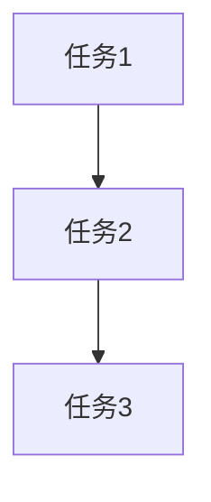
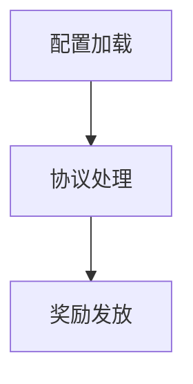

# tasks/server-implementation.md 生成规则（精简版 v2）

> **说明**: 本文档定义服务端实施任务（tasks/*.md）的生成规则。
> 
> **设计哲学**: 规则文件只包含"任务拆分的质量标准"，所有代码模板通过 CodeGraph 查询获取。

---

## 零、服务端架构设计强制要求（阻断性）

**生成服务端具体任务（3.1 及以后）前，必须先在 tasks.md 的"3.0 服务端架构设计"章节填写完整的架构设计，不得留空或跳过。**

### 0.1 为什么需要

服务端业务模块没有强制的分层框架约束（不像客户端有 Module/Page/Cell 三层），AI 容易把新功能全部塞进已有的 `XxxFunc.cpp`，导致单文件承载多条互不相关的业务线（如月卡功能把日常领取、组合套餐、赠送三条线全堆进同一个 1000+ 行文件）。架构设计章节强制在写代码前先决定文件边界。

### 0.2 架构设计的知识来源

**服务端没有独立的架构知识库**，本节内容由以下两处产出：
1. **design.md 附录 B**（服务端详细设计）——模块定义、Record 表定义、依赖模块清单已经在 design 阶段产出，3.0 章节是对这些信息的结构化提炼，不是重新设计
2. **CodeGraph 查询同类模块**——对照项目里文件拆分粒度相近的模块（如 `MixGrowthFundModule` 对应 `MixGrowthFundFunc.cpp`/`MixGrowthFundEventCallBack.cpp`），判断本次是否需要拆出独立文件

**执行步骤**：
1. 读取 `design.md` 附录 B 的"模块定义"章节，确认是新建模块还是修改既有模块
2. 若是修改既有模块：检查现有 `XxxFunc.cpp` 当前行数和已承载的业务线数量
   ```bash
   wc -l FsGame/ActivityModule/BusinessActivity/XxxFunc.cpp
   grep -c "^int XxxModule::\|^void XxxModule::\|^bool XxxModule::" FsGame/ActivityModule/BusinessActivity/XxxFunc.cpp
   ```
3. 用 CodeGraph 查询 1-2 个同类模块的文件拆分方式作参考：
   ```bash
   codegraph explore "MixGrowthFundModule MixGrowthFundFunc MixGrowthFundEventCallBack Init"
   ```
4. 判断标准：**新增的业务线是否与既有业务线共享数据结构/校验逻辑**
   - 共享（如都读同一个 Record 表、走同一个充值分派）→ 可以留在同一文件，但要在 3.0.3 里明确函数边界
   - 不共享（如本次月卡新增"组合套餐"“赠送”与既有"日常领取"除了活动开关外几乎不共享代码）→ 应拆成独立文件，如 `MonthCardSuitFunc.cpp`/`MonthCardGiftFunc.cpp`，参照 `GrowthFund/` 目录下 `GrowthFundFunc.cpp` 与 `MixGrowthFundFunc.cpp` 并存的做法（同一活动类型下按版本/子玩法拆文件）

### 0.3 架构设计章节结构（对应模板 tasks.md 的 3.0）

```markdown
### 3.0 服务端架构设计

#### 3.0.1 模块与文件组织
列出本次涉及的模块名、现有文件是否复用/需要拆分新文件，参考同类模块的文件拆分粒度

#### 3.0.2 Hook 注册清单
列出本次需要注册的 Hook 类型及各自用途：
| Hook 类型 | 用途 | 触发时机 |
|----------|------|---------|
| AddCustomHook | 处理客户端协议 | 收到指定协议号 |
| AddNotifyHook(BizActivNtf_OnStart/OnRemove) | 活动生命周期 | 活动开启/关闭 |
| AddRefreshHook(REFRESH_TIME_ID_DAILY_FIVE) | 每日定时刷新 | 每日 05:00 |
| RegisterDisposeFunc | 充值发货回调 | 充值到账 |
| RegistOnlineToDealOfflineFunc | 跨服/离线消息处理 | 收到 M2O 消息 |

#### 3.0.3 业务线拆分决策
如果一个模块要承载多条业务线，说明每条业务线对应哪些函数、放在哪个文件，是否需要拆出独立 .cpp。给出理由（共享数据结构 vs 独立校验逻辑）
```

### 0.4 常见的 Hook 注册体系（供 3.0.2 参考，完整定义以代码为准）

| Hook | 所属模块 | 典型用途 |
|------|---------|---------|
| `g_pBizActivModule->AddCustomHook<ActivityType, ProtocolID, KERNELTYPE_LOCAL>` | BizActivModule | 客户端协议入口（领取、查询等） |
| `g_pBizActivModule->AddNotifyHook(ActivityType, BizActivNtf_OnStart/OnRemove, ...)` | BizActivModule | 活动开启/关闭时初始化或清理玩家数据 |
| `g_pBizActivModule->AddRefreshHook<ActivityType, REFRESH_TIME_ID_XXX>` | BizActivModule | 每日/每周定时刷新 |
| `g_pRechargeModule->RegisterDisposeFunc(RECHARGE_TYPE_XXX, OnXxxDispose)` | RechargeModule | 充值到账后发货，一个活动可能有多个充值类型分派到不同处理函数 |
| `g_pPlayerDataModule->RegistOnlineToDealOfflineFunc(M2O_MSG_XXX, ...)` | PlayerDataModule | 跨服/离线消息（如赠送查询接收方状态） |

**CodeGraph 查询模板**：
```bash
codegraph explore "MonthCardModule Init AddCustomHook AddNotifyHook RegisterDisposeFunc"
codegraph explore "MixGrowthFundModule Init RegisterDisposeFunc OnBizActivStart"
```

---

## 一、任务拆分粒度规则

### 1.1 粒度标准（阻断性）

**合格的任务粒度**：

| 标准 | 要求 | 检查方式 |
|-----|------|---------|
| **实现时间** | 30 分钟 ~ 2 小时 | 估算单个任务的代码量 |
| **代码行数** | 50 ~ 200 行 | 统计任务涉及的代码行数 |
| **独立验证** | 可独立运行验证 | 任务完成后能否单独测试 |
| **单一职责** | 只做一件事 | 任务描述是否包含"和""以及" |

---

### 1.2 禁止的任务类型（阻断性）

❌ **过于宽泛**：
- "实现 XXXModule 全部功能"
- "完成服务端逻辑"
- "实现数据库操作"

❌ **过于细碎**：
- "定义 XXX 变量"
- "添加 include 语句"

---

### 1.3 合格的任务示例

✅ **模块初始化**：
```
任务：实现 GrowthFundModule 初始化
内容：加载配置表、注册协议回调、注册事件监听
估算：1 小时，约 80 行代码
验证：模块加载无报错，配置表解析成功
```

✅ **协议处理**：
```
任务：实现购买请求协议处理
内容：解析协议参数、校验购买条件、更新 Record 表、写统计日志
估算：1.5 小时，约 150 行代码
验证：客户端发送协议，服务器正确处理并更新 Record
```

✅ **配置加载**：
```
任务：实现 GrowthFundMainConfig 配置加载
内容：定义配置结构体、实现加载函数、存储到 map
估算：1 小时，约 100 行代码
验证：服务器启动时配置加载成功，无报错
```

---

## 二、任务生成指南

### 2.1 从 design 文档生成任务

**生成流程**：
```
读取 design/server.md 的"关键功能说明"章节
  ↓
每个功能拆分为 1-3 个任务
  ↓
每个任务包含：文件路径、实现内容、代码模板查询、验证方式
```

**示例**（基于 design 文档的"充值回调处理"功能）：
```markdown
### 任务 1：实现充值回调处理函数

**文件**: `FsGame/ActivityModule/GrowthFundModule/GrowthFundFunc.cpp`

**实现内容**:
- 实现 `OnGrowthFundDispose` 函数
- 校验充值档位是否匹配配置
- 检查是否重复购买
- 写入购买记录到 `GROWTH_FUND_OPEN_REC`
- 写统计日志

**代码模板获取**:
```
CodeGraph 查询：OnGrowthFundDispose 充值回调 RECHARGE_DISPOSE_RES_CODE
参考模块：AccrueRechargeModule, FirstRechargeModule
```

**验证方式**:
- 客户端购买成长基金，触发充值
- 服务器日志显示回调被触发
- 检查 Record 表有购买记录
```

---

### 2.2 任务文件结构

```markdown
# Tasks: {功能名称} - Server

## 任务列表

### 任务 1：{任务名称}
**文件**: {文件路径}
**实现内容**: {箭头列表}
**代码模板获取**: {CodeGraph 查询}
**验证方式**: {验证步骤}

### 任务 2：{任务名称}
（重复上述结构）

## 任务依赖关系



## 验收标准

- [ ] 所有任务完成
- [ ] 代码编译通过
- [ ] 功能验证通过（见各任务验证方式）
- [ ] 代码审查通过
```

---

## 三、代码模板查询指南

所有代码模板通过 CodeGraph 查询获取。

### 3.1 模块相关

| 任务类型 | CodeGraph 查询 | 参考模块 |
|---------|---------------|---------|
| 模块初始化 | `ILogicModule Init LoadResource` | CardModule, AccrueRechargeModule |
| 事件注册 | `ADD_EVENT_HOOK OnRecover` | - |
| 命令注册 | `ADD_INT_COMMAND_HOOK` | - |

---

### 3.2 配置相关

| 任务类型 | CodeGraph 查询 | 参考模块 | 说明 |
|---------|---------------|---------|------|
| 静态配置加载 | `READ_FILE LoadResource txt.ReadInt` | AccrueRechargeModule.cpp | 打包时加载，运行时不变，不推送客户端 |
| 旧活动文件整表同步 | `READ_SYNC_FILE LoadResource load_sync_file` | 同步入口确认后的 SE 同类活动模块 | 接入 ConfigSyncModule 文件拉取链；仅此分支要求 READ_SYNC_FILE |
| 数据库配置同步 / 独立业务协议 | 按 design/config.md 指定的登记、请求与回包入口查询 | 当前 SE 实际实现 | 拆分对应登记/同步或协议任务，不强制改成活动文件同步宏 |
| 配置结构体 | `struct ST 配置结构体` | AccrueRechargeModule.h | 定义配置字段映射 |

**先判加载方式，再判同步入口**：
- **静态配置**：按 SE 实际静态加载方式使用 `READ_FILE`，无运行时同步需求不添加同步任务。
- **运行时动态配置**：沿用 `design/config.md` 已核实的入口。旧活动文件拉取链才要求 `READ_SYNC_FILE`；数据库入口核查实际服务端登记/同步与客户端版本、请求、回包解析；独立业务协议核查协议字段和收发链。
- 入口不明确时先补设计证据，不因“运营活动”或“动态配置”标签自动选宏；不能仅凭 `READ_FILE` 就断定所有入口都无法同步。具体门禁见 `rules/design/config-structure.md` 和 `rules/common/se-config-generation.md`（相对于 schema 根目录）。

**READ_SYNC_FILE 宏作用（仅旧活动文件拉取链）**：
- 在 `READ_FILE` 基础上额外调用 `load_sync_file()` → `ConfigSyncModule::LoadFile()`
- 将配置表注册进 `ConfigSyncModule::mFileMap`，客户端才能通过 `CLIENT_CUSTOMMSG_PULL_CFGSYNC_FILES` 拉取
- 宏参数与 `READ_FILE` 完全一致，只需替换宏名即可接入同步

---

### 3.3 协议相关

| 任务类型 | CodeGraph 查询 | 参考模块 |
|---------|---------------|---------|
| 协议处理 | `OnCustom PERSISTID IVarList args.IntVal` | CardModule, FirstRechargeModule |
| 协议下发 | `Custom CVarList SERVER_CUSTOMMSG` | - |

---

### 3.4 Record 相关

| 任务类型 | CodeGraph 查询 | 参考模块 |
|---------|---------------|---------|
| Record 表定义 | `#define REC enum COL` | BusinessActivityDefine.h |
| Record 访问 | `GetRecord QueryInt FindInt` | - |

---

## 四、常见问题 FAQ

### Q1: 如何判断任务拆分是否合理？

**A**: 检查以下标准：
- 任务描述是否清晰（无"等""以及"等模糊词）
- 任务是否可独立验证（不依赖其他任务完成）
- 任务是否符合粒度标准（30 分钟 ~ 2 小时）

---

### Q2: 如果任务过大怎么办？

**A**: 按职责拆分：
- 过大任务："实现领取奖励功能"
- 拆分后：
  - 任务 1：实现领取条件校验
  - 任务 2：实现奖励发放
  - 任务 3：实现协议返回

---

### Q3: 如何处理任务依赖？

**A**: 在"任务依赖关系"章节使用 Mermaid 图标注依赖：


---

**版本**: v2 (精简版)  
**最后更新**: 2026-07-22  
**维护原则**: 只包含"任务拆分的质量标准"，代码模板通过 CodeGraph 查询
